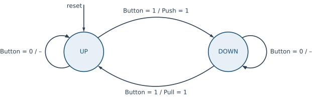
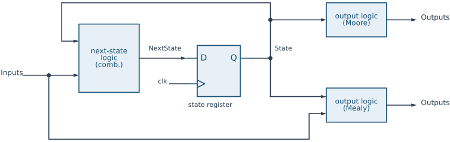

# Finite State Machines {#sec-fsm .unnumbered}

## Goal for this week

- Know what a finite state machine is, and where it is used in a digital
  system
- Describe an FSM with a state diagram and with an ASM chart
- Tell Moore and Mealy machines apart, and choose a state encoding
- Write an FSM in SystemVerilog as state register, next-state logic and
  output logic
- Build a complete system from a tick generator and an FSM: a traffic light

## Theoretical foundations {#sec-fsm-theory}

::: {.content-visible unless-format="revealjs"}
The first part of this chapter is the theory: what a finite state machine is,
the ways to draw one, how it maps onto hardware, and how it is written in
SystemVerilog. We use a small example throughout, a controller for window
blinds. The second part (@sec-fsm-practice) applies all of it to a complete
design, a traffic light.
:::

### What is a finite state machine?

::: {.content-visible when-format="revealjs"}
- A system that is always in one of a **finite** number of **states**
- At each clock edge it moves to a **next state**, chosen from the current
  state and the **inputs**
- It sets its **outputs** according to the state (and possibly the inputs)
- Role: the **controller** of a larger system, which tells the **datapath**
  what to do and when
:::

::: {.content-visible unless-format="revealjs"}
A **finite state machine** (FSM) is a model of a system that, at any moment,
is in one of a finite number of internal **states**. The state summarizes
everything about the past that matters for the future: the machine does not
remember *how* it got into a state, only *which* state it is in. At each
clock edge, the machine moves to a **next state**, which depends on the
current state and on the external **inputs**, and it produces **outputs**
that depend on the state and, in some machines, on the inputs as well.

Formally, an FSM is a tuple $(S, I, O, \delta, \lambda, s_0)$:

- $S$ is the finite set of states, and $s_0 \in S$ the initial state, the one
  the machine enters on reset;
- $I$ and $O$ are the sets of input and output values;
- $\delta : S \times I \to S$ is the **next-state function**, which gives
  the next state for each combination of current state and input;
- $\lambda$ is the **output function**.

A counter is the simplest example: its states are the values 0 to 15, its
next-state function is "add one", and it has no inputs apart from the
reset. FSMs become interesting when the inputs steer them.

In a digital system, FSMs are the **controllers**. A larger design is
usually split into a **datapath**, the registers, adders and multiplexers
that process the data, and a **control path**, which examines the external
commands and the status of the datapath and activates the right control
signals at the right time. A UART transmitter, a bus interface waiting for a
response, a memory controller sequencing a read: in each of them, the part
that decides *what happens next* is an FSM.
:::

### Describing an FSM: the state diagram

{#fig-blinds-state width=85%}

::: {.content-visible when-format="revealjs"}
- One push button opens or closes the blinds, depending on where they are
- **States**: `UP`, `DOWN`
- **Arrows**: transitions, labelled *condition / outputs*
- Outputs not listed on an arrow are 0
:::

::: {.content-visible unless-format="revealjs"}
The most common way to describe an FSM is a **state diagram**: a directed
graph in which every node is a state and every arrow a transition.

Take a controller for window blinds. A single push button controls a servo
motor: if the blinds are up, a press pushes them down; if they are down, a
press pulls them up. The FSM has one input, `Button`, and two outputs,
`Push` and `Pull`, which drive the motor. It must remember where the blinds
are, so it needs two states, `UP` and `DOWN` (@fig-blinds-state).

Each arrow is labelled with a **condition** and, after a slash, the
**outputs** that are 1 when the machine takes that arrow. In `UP`, if
`Button` is 1 the machine raises `Push` and moves to `DOWN`. If `Button` is
0, it takes the arrow back to `UP`, and no output is active (the `–` after
the slash). `DOWN` is the mirror image, with `Pull`. The arrow marked
`reset` shows the initial state.

Designing an FSM always follows the same three steps, and the state diagram
is where they are written down:

1. **Define the states.** What must the machine remember? Here, whether the
   blinds are up or down.
2. **Define the transitions.** For each state and each input combination,
   which state comes next? Every state must have a way out for *every*
   input combination, even if that way is "stay here".
3. **Define the outputs.** Which outputs are active, in which state, and
   under which input?

The same information can be written as a **state table**, one row per
state and input combination:

| State | `Button` | Next state | `Push` | `Pull` |
|---|---|---|---|---|
| `UP` | 0 | `UP` | 0 | 0 |
| `UP` | 1 | `DOWN` | 1 | 0 |
| `DOWN` | 0 | `DOWN` | 0 | 0 |
| `DOWN` | 1 | `UP` | 0 | 1 |

The table is the next-state function $\delta$ and the output function
$\lambda$ written out in full. It is the most precise description, but it
grows with every state and every input bit, so for anything but tiny
machines we draw the diagram instead.
:::

### The structure of an FSM in hardware

{#fig-fsm-structure}

::: {.content-visible when-format="revealjs"}
- **Next-state logic**: combinational, computes $\delta$
- **State register**: flip-flops, the only memory
- **Output logic**: combinational, computes $\lambda$
- The loop through the register is the same as in a counter
:::

::: {.content-visible unless-format="revealjs"}
In hardware, every FSM has the same three parts (@fig-fsm-structure):

- The **state register** stores the current state. It is a set of
  flip-flops, all clocked by the system clock, and it is the only memory in
  the machine. On reset it loads the initial state.
- The **next-state logic** is a combinational circuit that implements
  $\delta$: from the current state and the inputs, it computes `NextState`,
  which the register loads at the next clock edge.
- The **output logic** is a combinational circuit that implements
  $\lambda$ and produces the outputs.

The loop from the register output, through the next-state logic, and back
into the register is the same loop as in the counter of the previous
chapter, written in its *way 2*: the register only stores, and all the
decisions are in the combinational logic in front of it. An FSM is a
counter whose "+ 1" has been replaced by an arbitrary function of the state
and the inputs.
:::

### Moore and Mealy machines

{#fig-blinds-wave}

::: {.content-visible when-format="revealjs"}
| | Moore | Mealy |
|---|---|---|
| Outputs depend on | state only | state **and** inputs |
| Output written in | the state | the transition |
| Reacts to an input | one cycle later | in the same cycle |
| Path input → output | none | combinational |
:::

::: {.content-visible unless-format="revealjs"}
The output logic in @fig-fsm-structure comes in two forms, and they give the
two classic kinds of FSM:

- In a **Moore machine**, the outputs depend **only on the current state**:
  $\lambda : S \to O$. The outputs are written inside the states of the
  diagram, and they change only at a clock edge, when the state changes. A
  traffic light is a Moore machine: the lamps are a function of the state.
- In a **Mealy machine**, the outputs depend on the **current state and the
  inputs**: $\lambda : S \times I \to O$. The outputs are written on the
  arrows, as in @fig-blinds-state. The blinds controller is a Mealy
  machine: `Push` is 1 only in `UP` *and* only while `Button` is 1.

@fig-blinds-wave shows what this means in time. In column 2 `Button` is 1,
and `Push` is 1 in that same cycle, before the state has changed; the state
becomes `DOWN` only at the edge that starts column 3. The same happens with
`Pull` in column 6.

The two kinds trade speed against safety:

| | Moore | Mealy |
|---|---|---|
| Outputs depend on | the state only | the state and the inputs |
| In the diagram, outputs are written | in the states | on the transitions |
| Reaction to an input | one clock cycle later | in the same cycle |
| Combinational path from input to output | no | yes |
| Number of states | often more | often fewer |

A Mealy machine reacts one cycle earlier and often needs fewer states. To
get a one-cycle `Push` pulse from a Moore machine, the blinds controller
would need extra states such as `PUSHING` and `PULLING`, in which the output
is active. The price of a Mealy machine is the combinational path from
input to output. Any glitch on the input appears on the output, and the
path adds to the timing of whatever the output drives. If two Mealy
machines feed each other, the paths can even close into a combinational
loop. In this book we prefer Moore outputs, and use Mealy outputs where the
one-cycle reaction really matters, for example for a one-cycle `Done` pulse.
:::

### State encoding

::: {.content-visible when-format="revealjs"}
| State | Binary | Gray | One-hot |
|---|---|---|---|
| `RED` | `00` | `00` | `0001` |
| `RED_YELLOW` | `01` | `01` | `0010` |
| `GREEN` | `10` | `11` | `0100` |
| `YELLOW` | `11` | `10` | `1000` |

- Binary, Gray: $\lceil \log_2 N \rceil$ flip-flops; one-hot: $N$ flip-flops
- FPGA: flip-flops are cheap, one-hot is often fastest
:::

::: {.content-visible unless-format="revealjs"}
The states have names in the diagram, but the state register stores bits,
so every state needs a binary code. The choice of codes is the **state
encoding**, and there are three common ones. For $N$ states:

- **Binary** encoding numbers the states 0, 1, 2, … and needs
  $\lceil \log_2 N \rceil$ flip-flops. It is the most compact.
- **Gray** encoding uses the same number of flip-flops, but assigns codes so
  that states that follow each other differ in a single bit. That reduces
  switching activity, and so power, when the machine mostly moves along a
  fixed sequence.
- **One-hot** encoding uses one flip-flop per state, and exactly one of them
  is 1 at a time. It needs $N$ flip-flops, but the logic becomes very
  simple: "are we in `GREEN`?" is a single bit, not a comparison.

For the four states of the traffic light in the second part of this chapter:

| State | Binary | Gray | One-hot |
|---|---|---|---|
| `RED` | `00` | `00` | `0001` |
| `RED_YELLOW` | `01` | `01` | `0010` |
| `GREEN` | `10` | `11` | `0100` |
| `YELLOW` | `11` | `10` | `1000` |

The traffic light cycles `RED`, `RED_YELLOW`, `GREEN`, `YELLOW`, `RED`, so
with the Gray codes every transition flips exactly one bit, including the
one back to the start.

On an FPGA, flip-flops are plentiful (every slice has eight of them, as we
saw in the FPGA chapter), while logic depth decides the clock speed. One-hot
encoding trades a few flip-flops for shallower next-state and output logic,
and is often the fastest choice. In practice, the synthesis tool recognizes
FSMs in the code and usually picks the encoding itself: Vivado re-encodes a
machine it extracts, and can be overruled with the `fsm_encoding`
attribute. What we write in the code is the *meaning* of the states, and
the encoding is an implementation detail.
:::

### The ASM chart

{#fig-blinds-asm width=60%}

::: {.content-visible when-format="revealjs"}
- **State box**: the state name, and its Moore outputs
- **Decision box**: a condition, with a `0` and a `1` exit
- **Conditional output box**: Mealy outputs and register updates on that
  path
- One **ASM block** (a state box and everything below it) = one clock cycle
:::

::: {.content-visible unless-format="revealjs"}
A state diagram gets crowded quickly: when there are several inputs, and
when the machine also has to update counters or registers, the labels on
the arrows become long expressions. An **algorithmic state machine** (ASM)
chart shows the same information as a flowchart, which is easier to follow
step by step. It uses three kinds of boxes (@fig-blinds-asm):

- A rectangular **state box** stands for one state. It holds the state name
  and the **Moore outputs** that are 1 in that state. Outputs that are not
  listed are 0.
- A diamond is a **decision box**. It tests an input or an internal signal,
  and has a `0` and a `1` exit.
- A rounded **conditional output box** holds the **Mealy outputs** that are
  1 on that path, and the register updates (such as `Count++`) that happen
  on that path.

A state box with all the decision and conditional boxes below it, up to the
arrows that enter the next state boxes, forms an **ASM block**, and one ASM
block is one clock cycle. During the cycle, the machine is in the state of
the state box, the decisions are evaluated by the next-state logic, and the
outputs of the conditional boxes on the active path are 1. At the clock edge
the machine follows the active path into the next state.

Compare @fig-blinds-asm with @fig-blinds-state: the self-loops of the state
diagram are the `0` exits of the decisions, and the outputs that were
written after the slash are now in the conditional boxes. The ASM chart has
another advantage: it maps line by line onto the SystemVerilog code, as the
next section shows.
:::

### Describing an FSM in SystemVerilog

::: {.content-visible when-format="revealjs"}
```systemverilog
typedef enum logic {UP, DOWN} state_t;
state_t State, NextState;

// state register
always_ff @(posedge clk)
  if (reset) State <= UP;
  else       State <= NextState;

// next-state logic
always_comb begin
  NextState = State;                     // default: stay
  case (State)
    UP:      if (Button) NextState = DOWN;
    DOWN:    if (Button) NextState = UP;
    default: NextState = UP;
  endcase
end

// output logic (Mealy)
assign Push = (State == UP) && Button;
assign Pull = (State == DOWN) && Button;
```
:::

::: {.content-visible unless-format="revealjs"}
The three hardware parts of @fig-fsm-structure become three pieces of code.
Here is the blinds controller, written according to the HIPV coding
conventions:

```systemverilog
///////////////////////////////////////////////////////////////////////
// blinds_fsm
//
// Purpose: Window-blinds controller. A press of Button pushes the
//          blinds down when they are up, and pulls them up when
//          they are down.
///////////////////////////////////////////////////////////////////////

module blinds_fsm(
  input  logic clk, reset,
  input  logic Button,
  output logic Pull, Push);

  typedef enum logic {UP, DOWN} state_t;

  state_t State, NextState;

  // state register
  always_ff @(posedge clk)
    if (reset) State <= UP;
    else       State <= NextState;

  // next-state logic
  always_comb begin
    NextState = State;                     // default: stay
    case (State)
      UP:      if (Button) NextState = DOWN;
      DOWN:    if (Button) NextState = UP;
      default: NextState = UP;
    endcase
  end

  // output logic (Mealy: depends on the state and the input)
  assign Push = (State == UP) && Button;
  assign Pull = (State == DOWN) && Button;

endmodule
```

**The states** are an enumerated type. `typedef enum logic {UP, DOWN}
state_t;` defines a new type, `state_t`, whose values have names. The
simulator shows those names in the waveform instead of bits, and the
compiler refuses to assign an unrelated value to a `state_t` signal without
a cast. Without explicit values the encoding is binary, in the order listed;
to choose another encoding, give the values explicitly:

```systemverilog
typedef enum logic [3:0] {RED        = 4'b0001,     // one-hot
                          RED_YELLOW = 4'b0010,
                          GREEN      = 4'b0100,
                          YELLOW     = 4'b1000} state_t;
```

Following the HIPV naming convention, the state names are constants and are
written in MACRO_CASE, the type name ends in `_t`, and the signals `State`
and `NextState` are in UpperCamelCase.

**The state register** is an `always_ff` with a synchronous reset, exactly
the register of the previous chapter. Reset loads the initial state.

**The next-state logic** is an `always_comb` with a `case` on the current
state, one branch per state. It begins by assigning the default
`NextState = State`, "stay where you are". This is the *default first, then
override* pattern: every `if` without an `else` falls back on the default,
which is exactly the `0` exit of a decision in the ASM chart, and
`NextState` is assigned on every path, so no latch can appear. The `default`
branch of the `case` catches state codes that do not belong to any state.
With two states in one bit there are none, but in a one-hot machine most of
the codes are illegal, and the `default` sends the machine back to a known
state instead of leaving it stuck.

**The output logic** is two `assign` statements. Because they read
`Button`, this is a Mealy machine. In a Moore machine, the output logic
reads only `State`.

One practical remark. `Button` must be a one-cycle pulse that is
**synchronous** to `clk`. A real push button is neither: it bounces for
milliseconds, and it is held for millions of clock cycles, during which this
FSM would toggle at every edge. On a board, the button first passes through
a synchronizer, a debouncer and an edge detector, and only their one-cycle
output reaches the FSM. We return to synchronizers in a later chapter.
:::

### FSMs with data registers

::: {.content-visible when-format="revealjs"}
- Real FSMs also keep **counters and registers**: an FSM with datapath (FSMD)
- Each register `X` gets an `XNext`, computed in the next-state logic
- `X` = the value now, `XNext` = the value after the next clock edge
- All of them are loaded together in the state register block
:::

::: {.content-visible unless-format="revealjs"}
The blinds controller remembers one bit. Real controllers also have to
remember numbers: how many bits of a UART frame have been sent, or how many
milliseconds a traffic light has been green. In principle we could make
every count a separate state (`GREEN_0`, `GREEN_1`, …, `GREEN_3999`), but that
is absurd. Instead, we keep the counter in a register next to the state
register. The **state** is then the named control state *plus* the contents
of these data registers, and the machine is called an **FSM with datapath**
(FSMD).

The coding pattern stays the same, and extends to every such register. Each
register `X` gets a companion signal `XNext`:

- `X` is the **current** value, the output of the register;
- `XNext` is the **next** value, computed by the next-state logic, and loaded
  into `X` at the next clock edge.

The `always_ff` block loads all of them together (`State <= NextState;
Count <= CountNext;`), and the `always_comb` block computes all the `...Next`
signals, each with its default first: `CountNext = Count` means "keep the
value", and a branch overrides it where the count must change. In an ASM
chart, the register updates are the contents of the conditional boxes,
written as `Count++` or `Count = 0`. All updates in one ASM block happen at
the same clock edge, together with the change of state. The second part of
this chapter uses this pattern for the millisecond counter of the traffic
light.
:::

### Common mistakes

::: {.content-visible when-format="revealjs"}
- No default for `NextState`: a **latch**
- No `default` in the `case`: an illegal state can be a **trap**
- Using a counter bit as a **clock**: use it as an **enable**
- Asynchronous inputs straight into the FSM: **synchronize** first
- Mealy outputs feeding another Mealy machine: possible **combinational
  loop**
:::

::: {.content-visible unless-format="revealjs"}
Most FSM bugs fall into a few groups:

- **Latches.** If some path through the next-state logic does not assign
  `NextState` (or a `...Next` register value), the tool infers a latch. Start
  the `always_comb` block with the defaults.
- **Trap states.** A state code that no branch handles can keep the
  machine stuck forever after a glitch or a bad reset. Give every `case` a
  `default` branch that returns to a known state.
- **Derived clocks.** Slowing an FSM down by clocking it with a counter bit
  creates a second clock domain and breaks timing analysis. Keep the system
  clock everywhere, and let the counter produce a one-cycle **enable**
  (tick) that the FSM checks, as the traffic light does below.
- **Asynchronous inputs.** An input that can change at any moment, such as
  a button or a serial line, can violate the setup time of the state
  register and leave the FSM in an illegal state. Pass it through a
  synchronizer first.
- **Mealy chains.** A Mealy output that feeds the input of another Mealy
  machine, whose output comes back, forms a combinational loop. Register
  one of the outputs, or use Moore outputs.
:::

## Practical case: a traffic light {#sec-fsm-practice}

::: {.content-visible unless-format="revealjs"}
We now apply the theory to a complete, if small, system: the controller of
a traffic light. It is a Moore machine with a data register, it needs time
intervals that are long compared with the clock period, and it is built from
two modules, a counter that marks time and an FSM that uses it.
:::

### Specification

::: {.content-visible when-format="revealjs"}
| State | Lights | Time |
|---|---|---|
| `RED` | red | 5 s |
| `RED_YELLOW` | red + yellow | 1 s |
| `GREEN` | green | 4 s |
| `YELLOW` | yellow | 2 s |

- Clock: 100 MHz, synchronous reset into `RED`
:::

::: {.content-visible unless-format="revealjs"}
The traffic light cycles through four states, and each state lights a
different combination of lamps for a different time:

| State | Lights | Time |
|---|---|---|
| `RED` | red | 5 s |
| `RED_YELLOW` | red and yellow | 1 s |
| `GREEN` | green | 4 s |
| `YELLOW` | yellow | 2 s |

The system clock is 100 MHz, and a synchronous reset puts the light into
`RED`. The outputs `Red`, `Yellow` and `Green` drive the three lamps, and
depend only on the state, so the controller is a Moore machine.
:::

### System architecture

{#fig-traffic-system}

::: {.content-visible when-format="revealjs"}
- `tick_gen`: a counter, one `Tick` pulse every 100 000 cycles = 1 ms
- `traffic_fsm`: counts ticks in `MsCount`, changes state when the time is up
- `Tick` is an **enable**, not a clock: both blocks use `clk`
:::

::: {.content-visible unless-format="revealjs"}
The times are long compared with the clock period. At 100 MHz, 5 s is
500 million cycles, and counting them directly would need a 29-bit counter
compared against a large constant in every state. We split the job in two,
the same way a UART uses a baud-rate generator (@fig-traffic-system):

- `tick_gen` is a counter that produces a one-cycle pulse, `Tick`, once every
  millisecond.
- `traffic_fsm` is the FSM. It counts those pulses in a data register,
  `MsCount`, and when the count reaches the time of the current state, it
  moves on to the next state.
- `traffic_light` is the top level, which only connects the two.

The FSM still runs on the 100 MHz clock: `Tick` is an *enable*, not a slower
clock. Every flip-flop in the design sees the same clock edge, which is the
synchronous-design rule of the HIPV coding standard, and the time unit of the
FSM is now a millisecond, so the times in the specification appear in the
code unchanged.
:::

### The 1 ms tick generator

::: {.content-visible when-format="revealjs"}
```systemverilog
module tick_gen #(parameter TICK_CYCLES = 100_000) (
  input  logic clk, reset,
  output logic Tick);

  localparam CNT_WIDTH = $clog2(TICK_CYCLES);

  logic [CNT_WIDTH-1:0] Count;

  always_ff @(posedge clk)
    if (reset || Tick) Count <= '0;
    else               Count <= Count + 1;

  assign Tick = (Count == TICK_CYCLES - 1);

endmodule
```
:::

::: {.content-visible unless-format="revealjs"}
The tick generator is a counter with a comparator. It counts from 0 to
`TICK_CYCLES - 1`, raises `Tick` for the one cycle in which it holds that
last value, and starts again from 0:

```systemverilog
///////////////////////////////////////////////////////////////////////
// tick_gen
//
// Purpose: One-cycle Tick pulse every TICK_CYCLES clock cycles
//          (1 ms with the default value and a 100 MHz clock).
///////////////////////////////////////////////////////////////////////

module tick_gen #(parameter TICK_CYCLES = 100_000) (
  input  logic clk, reset,
  output logic Tick);

  localparam CNT_WIDTH = $clog2(TICK_CYCLES);

  logic [CNT_WIDTH-1:0] Count;

  always_ff @(posedge clk)
    if (reset || Tick) Count <= '0;
    else               Count <= Count + 1;

  assign Tick = (Count == TICK_CYCLES - 1);

endmodule
```

The period of `Tick` is exactly `TICK_CYCLES` clock cycles, because the
counter spends one cycle at each of the values 0 to `TICK_CYCLES - 1`. With
the default of 100 000 and a 100 MHz clock, that is 1 ms. The counter width
is derived from the parameter with `$clog2`, which the tool evaluates at
compile time, and it is a `localparam` because nobody outside should change
it. `Tick` itself is a Moore-style output of the counter: it depends only on
the register `Count`, so it is clean for a whole clock cycle.
:::

### The ASM chart of the traffic light

{#fig-traffic-asm}

::: {.content-visible when-format="revealjs"}
- State boxes hold the **Moore** outputs: the lamps
- Conditional boxes update the data register `MsCount`
- `Tick = 0`: stay, nothing changes
- `Tick = 1`, not the last: `MsCount++`
- `Tick = 1`, the last: `MsCount = 0`, next state
:::

::: {.content-visible unless-format="revealjs"}
The ASM chart (@fig-traffic-asm) has one column per state. The state boxes
hold the Moore outputs, the lamps that are on. There are no Mealy outputs, so
the conditional boxes contain only the updates of the data register
`MsCount`.

Read the `RED` column. In this state the red lamp is on. If `Tick` is 0, we
take the `0` exit back to the entry of `RED`: nothing changes. If `Tick` is
1, a millisecond has passed, and the second decision checks whether it was
the last one. If not, `MsCount` is incremented and we stay in `RED`. If it
was, `MsCount` is cleared and the FSM moves to `RED_YELLOW`. The other three
columns are the same, each with its own time and its own successor, and
`YELLOW` returns to `RED`.

The `- 1` in the decisions comes from counting from 0. After `RED_MS - 1`
ticks, the count holds `RED_MS - 1`, and the tick that arrives while the
count holds that value is the `RED_MS`-th one. The FSM leaves the state on
exactly that tick.
:::

### The FSM in SystemVerilog

::: {.content-visible when-format="revealjs"}
```systemverilog
  // next-state logic
  always_comb begin
    NextState   = State;
    MsCountNext = MsCount;
    if (Tick) MsCountNext = MsCount + 1;
    case (State)
      RED:
        if (Tick && MsCount == RED_MS - 1) begin
          NextState   = RED_YELLOW;
          MsCountNext = '0;
        end
      ...
    endcase
  end

  // output logic
  assign Red    = (State == RED) || (State == RED_YELLOW);
  assign Yellow = (State == RED_YELLOW) || (State == YELLOW);
  assign Green  = (State == GREEN);
```
:::

::: {.content-visible unless-format="revealjs"}
The code follows the chart box by box, and uses the FSMD pattern for
`MsCount`:

```systemverilog
///////////////////////////////////////////////////////////////////////
// traffic_fsm
//
// Purpose: Traffic-light controller. Cycles through RED, RED_YELLOW,
//          GREEN and YELLOW, and holds each state for its own number
//          of 1 ms ticks.
///////////////////////////////////////////////////////////////////////

module traffic_fsm #(parameter RED_MS = 5000, RED_YELLOW_MS = 1000,
                               GREEN_MS = 4000, YELLOW_MS = 2000) (
  input  logic clk, reset,
  input  logic Tick,
  output logic Red, Yellow, Green);

  localparam CNT_WIDTH = 16;               // enough for 65 s per state

  typedef enum logic [1:0] {RED, RED_YELLOW, GREEN, YELLOW} state_t;

  state_t               State, NextState;
  logic [CNT_WIDTH-1:0] MsCount, MsCountNext;

  // state register
  always_ff @(posedge clk)
    if (reset) begin
      State   <= RED;
      MsCount <= '0;
    end else begin
      State   <= NextState;
      MsCount <= MsCountNext;
    end

  // next-state logic
  always_comb begin
    NextState   = State;                   // default: stay in the state
    MsCountNext = MsCount;                 //          and keep the count
    if (Tick) MsCountNext = MsCount + 1;   // count the elapsed milliseconds
    case (State)
      RED:
        if (Tick && MsCount == RED_MS - 1) begin
          NextState   = RED_YELLOW;
          MsCountNext = '0;
        end
      RED_YELLOW:
        if (Tick && MsCount == RED_YELLOW_MS - 1) begin
          NextState   = GREEN;
          MsCountNext = '0;
        end
      GREEN:
        if (Tick && MsCount == GREEN_MS - 1) begin
          NextState   = YELLOW;
          MsCountNext = '0;
        end
      YELLOW:
        if (Tick && MsCount == YELLOW_MS - 1) begin
          NextState   = RED;
          MsCountNext = '0;
        end
      default: NextState = RED;
    endcase
  end

  // output logic: the lights depend on the state only
  assign Red    = (State == RED) || (State == RED_YELLOW);
  assign Yellow = (State == RED_YELLOW) || (State == YELLOW);
  assign Green  = (State == GREEN);

endmodule
```

**The state register** stores the control state and the data register
`MsCount`, and loads both together. On reset the FSM goes to `RED` with the
count at 0, which is the `reset` arrow of the chart.

**The next-state logic** starts with the defaults: stay in the current
state and keep the count. They cover the `Tick = 0` exits of every column
without a single `else`. The next line is the `MsCount++` box, which is the
same in every state, so we write it once: on every tick, count. The `case`
then handles the last tick of each state. It overrides both defaults: it
selects the next state and clears the counter. Because this assignment comes
later in the block, it wins over the increment, as the blocking `=`
guarantees. The `default` branch is not reachable with four states in two
bits, but it keeps the machine safe if the encoding changes.

**The output logic** is three `assign` statements, one per lamp, each a
function of `State` alone: this is a Moore machine, so the lamps change only
at a clock edge, when the state changes. The light times are parameters, so
another junction, with other times, is a different instance of the same
module.
:::

### The traffic light in the waveform

{#fig-traffic-wave}

::: {.content-visible when-format="revealjs"}
- Real times are 100 000 cycles per tick: scale them down to simulate
- `MsCount` counts ticks, the state changes on the **last** one
- Lights change only with `State`: Moore outputs
:::

::: {.content-visible unless-format="revealjs"}
With the real parameters, one traffic-light cycle lasts 12 s, or 1.2 billion
clock cycles, far too many to simulate or to draw. Because every time is a
parameter, the testbench can instantiate both modules with small values
instead: `TICK_CYCLES = 2`, and states of 4, 1, 3 and 2 ticks
(@fig-traffic-wave). The design is the same; only the numbers are smaller.

`reset` is high for the first edge, so in column 0 the FSM is in `RED` and
`MsCount` is 0. `Tick` is high in every second column. At each edge that
follows a tick, `MsCount` goes up by one: it is 1 in columns 2 and 3, 2 in
columns 4 and 5, and 3 in columns 6 and 7. In column 7 `Tick` is high and
`MsCount` is 3, which is `RED_MS - 1`, so the edge starting column 8 moves the
FSM to `RED_YELLOW` and clears the count. `RED` lasted 8 cycles, exactly 4
ticks. `RED_YELLOW` lasts only one tick: already in column 9, `Tick` is high
while `MsCount` is 0, which is `RED_YELLOW_MS - 1`, so at column 10 the FSM
moves to `GREEN`. `MsCount` stays 0 across that change, because it is
cleared, not incremented. `GREEN` counts 0, 1, 2 and `YELLOW` 0, 1, and at
column 20 the FSM is back in `RED`.

The bottom three rows are the lamps. They change only at the edges where
`State` changes, and the red lamp stays on through `RED_YELLOW`, as the
output logic says.
:::

### Putting it together

::: {.content-visible when-format="revealjs"}
```systemverilog
module traffic_light(
  input  logic clk, reset,
  output logic Red, Yellow, Green);

  logic Tick;

  tick_gen #(.TICK_CYCLES(100_000)) msgen (
    .clk(clk), .reset(reset), .Tick(Tick));

  traffic_fsm lightfsm (
    .clk(clk), .reset(reset), .Tick(Tick),
    .Red(Red), .Yellow(Yellow), .Green(Green));

endmodule
```
:::

::: {.content-visible unless-format="revealjs"}
The top level is purely structural, as the HIPV convention asks for a module
that only connects blocks. It is @fig-traffic-system in code: one instance of
each module, wired by name.

```systemverilog
///////////////////////////////////////////////////////////////////////
// traffic_light
//
// Purpose: Traffic light: a 1 ms tick generator driving the
//          traffic-light FSM.
///////////////////////////////////////////////////////////////////////

module traffic_light(
  input  logic clk, reset,
  output logic Red, Yellow, Green);

  logic Tick;

  tick_gen #(.TICK_CYCLES(100_000)) msgen (
    .clk(clk), .reset(reset), .Tick(Tick));

  traffic_fsm lightfsm (
    .clk(clk), .reset(reset), .Tick(Tick),
    .Red(Red), .Yellow(Yellow), .Green(Green));

endmodule
```

The split is what makes the design easy to change. A board with a 50 MHz
clock needs a different `TICK_CYCLES`, and a different junction needs
different light times; each is one parameter in one instance, and neither
touches the logic of the FSM. The same pattern, a counter that produces a
periodic tick and an FSM that uses the tick as an enable, appears in every
serial interface: in a UART, the tick marks the duration of one bit, and
the FSM steps through the start bit, the data bits and the stop bit.
:::
