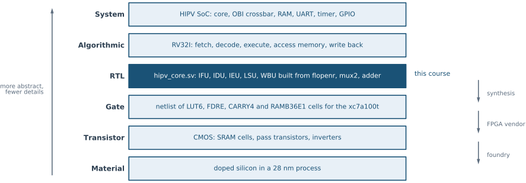
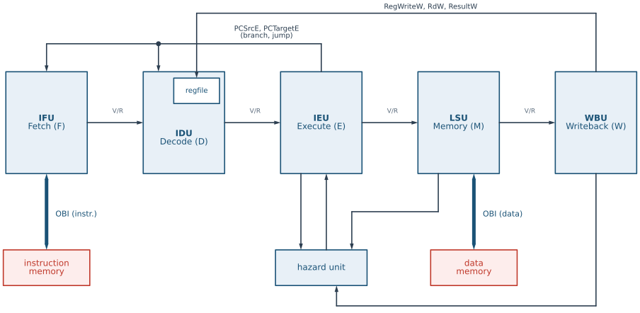

# Five-stage pipeline {#sec-pipeline-structure .unnumbered}

## Goal for this week

- Place the HIPV SoC on the levels of abstraction, from the system down to
  the silicon, and know at which level we design
- Translate the well-known pipeline theory (IF/ID/EX/MEM/WB) into SystemVerilog
- Apply SystemVerilog syntax immediately on a real, motivating example
- Treat memory (for now) as an interface — the implementation follows next week

::: {.content-visible when-format="revealjs"}
**Discussion question:** why do we implement pipeline registers as separate
modules, instead of "hiding" them inside each stage?
:::

::: {.content-visible unless-format="revealjs"}
We implement pipeline registers as separate modules for two reasons.
First, pedagogically: each such register is a direct, visible example of a
D flip-flop (DFF) in the context of a real processor, which was an explicit
goal of the second part of the course. Second, practically: separate
modules with a fixed interface (see `pipeline_pkg.sv`) allow us to
substitute an individual stage with a reference ("golden") implementation
in the jigsaw testing methodology — discussed in more detail in the
verification chapter. This five-stage IF/ID/EX/MEM/WB structure follows
the classic pipelined datapath described by @patterson2017comporg.
:::

## Levels of abstraction

{#fig-abstraction-levels}

::: {.content-visible when-format="revealjs"}
- One system, six descriptions: each level **hides** the details of the
  level below
- We design at **RTL**; synthesis takes it down to gates
- The FPGA vendor and the foundry did the levels below that for us
:::

::: {.content-visible unless-format="revealjs"}
Before we build the pipeline, it helps to step back and look at what we are
building from a distance. The HIPV SoC is a single system, but it can be
described at very different levels of detail: as a handful of blocks
connected by buses, as an algorithm that executes instructions, as a set of
registers and the logic between them, as a netlist of gates, as a circuit of
transistors, or as structures in doped silicon. These are the **levels of
abstraction** of digital design (@fig-abstraction-levels).

Each level describes the same system, but with fewer details than the level
below it. A description at a higher level is shorter and easier to reason
about, because it *hides* how its parts are built: at the system level the
core is a box, and we do not care whether its adder is a ripple-carry chain
or a carry-lookahead tree. A description at a lower level is closer to the
real hardware, and much larger. Moving down a level means adding
implementation decisions; moving up means leaving them out.

The earlier chapters of this book have already visited most of these
levels, bottom-up: silicon and the p-n junction, CMOS transistors and gates,
programmable devices and the FPGA, and finally SystemVerilog at the
register-transfer level. In this chapter we start working top-down, the way
a design is actually made, and we use HIPV as the example at every level.
:::

## System level

::: {.content-visible when-format="revealjs"}
- Blocks and the connections between them, no internal detail
- HIPV SoC: `hipv_core`, OBI crossbar, 64 KiB RAM, UART, timer, GPIO
- Decisions: which blocks, which bus, which address map, which clock
:::

::: {.content-visible unless-format="revealjs"}
At the **system level**, a design is a set of blocks and the connections
between them. The HIPV SoC (`rtl/top/hipv_soc.sv`) consists of:

- the RISC-V core, `hipv_core`, with two OBI master ports, one for
  instructions and one for data;
- an OBI crossbar that connects the two masters to five slaves;
- a 64 KiB RAM that holds both the program and the data;
- three peripherals: a UART, a timer and a GPIO block.

Nothing at this level says *how* any block works. The decisions made here
are about the system as a whole: which blocks there are, what bus connects
them and with which protocol, where each block sits in the address map,
and how fast the clock runs. For HIPV, the bus is OBI, the address map
gives every slave its own window, and the clock is 50 MHz on the Nexys
A7-100T board.
:::

## Algorithmic level

::: {.content-visible when-format="revealjs"}
```text
PC = 0
forever:
  instr = mem[PC]                               # fetch
  op, rd, rs1, rs2, imm = decode(instr)         # decode
  a = x[rs1];  b = x[rs2]
  case op:                                      # execute, memory, write back
    ALU:    x[rd] = alu(op, a, b or imm);  PC = PC + 4
    LOAD:   x[rd] = mem[a + imm];          PC = PC + 4
    STORE:  mem[a + imm] = b;              PC = PC + 4
    BRANCH: PC = taken(op, a, b) ? PC + imm : PC + 4
    JAL:    x[rd] = PC + 4;                PC = PC + imm
    JALR:   x[rd] = PC + 4;                PC = (a + imm) & ~1
```

- **What** the core computes, as an algorithm: no clock, no registers
:::

::: {.content-visible unless-format="revealjs"}
At the **algorithmic level**, a block is described by *what* it computes,
as an algorithm, without any notion of a clock or of the hardware that will
carry it out. For the HIPV core, that algorithm is the RV32I instruction set:
a loop that fetches the instruction at the program counter, decodes it, and
executes it:

```text
PC = 0
forever:
  instr = mem[PC]                               # fetch
  op, rd, rs1, rs2, imm = decode(instr)         # decode
  a = x[rs1];  b = x[rs2]
  case op:                                      # execute, memory, write back
    ALU:    x[rd] = alu(op, a, b or imm);  PC = PC + 4
    LOAD:   x[rd] = mem[a + imm];          PC = PC + 4
    STORE:  mem[a + imm] = b;              PC = PC + 4
    BRANCH: PC = taken(op, a, b) ? PC + imm : PC + 4
    JAL:    x[rd] = PC + 4;                PC = PC + imm
    JALR:   x[rd] = PC + 4;                PC = (a + imm) & ~1
```

Here `x` is the array of 32 registers (with `x[0]` always 0) and `mem` is the
memory. Every instruction is finished before the next one starts, and how
long each step takes is not part of the description. This is the level of
the RISC-V specification, and of an instruction-set simulator such as Spike,
which runs programs exactly according to this loop. It is the reference
against which every implementation is judged: whatever the pipeline does
internally, the registers and the memory must end up as the loop says.
:::

## Register-transfer level

{#fig-hipv-rtl}

::: {.content-visible when-format="revealjs"}
- Registers, and the combinational logic between them, on each **clock edge**
- HIPV: five stages, F, D, E, M, W, built from `flopenr`, `mux2`, `mux3`, `adder`
- The level we write in SystemVerilog
:::

::: {.content-visible unless-format="revealjs"}
At the **register-transfer level** (RTL), the algorithm is mapped onto
clocked hardware: a set of registers, and the combinational logic that
computes their next values at every clock edge. This is where time appears.
The loop of the algorithmic level is cut into five steps, fetch, decode,
execute, memory and write back, and each step becomes a pipeline stage with
its own registers, so that five instructions can be in progress at once
(@fig-hipv-rtl). The price is that instructions now overlap, and the RTL
must handle what the algorithm never had to think about: an instruction that
needs a result its predecessor has not yet written (forwarding, in the
hazard unit), and instructions fetched after a jump that must be thrown away
(the redirect from Execute).

This is the level of `hipv_core.sv` and of everything we have written in
SystemVerilog so far: the leaf cells (`flopenr`, `mux2`, `mux3`, `adder`) in
behavioral style, the stages assembled from them structurally, and the
control FSMs. It is the lowest level at which we still make the design
decisions ourselves, and the highest level that tools can turn into hardware
automatically. That is why almost all digital design is done here, and why
the rest of this course works at this level.
:::

## Gate level

::: {.content-visible when-format="revealjs"}
- A **netlist**: cells and the wires between them
- On the FPGA, the cells are the primitives of the xc7a100t: `LUT6`, `FDRE`,
  `CARRY4`, `RAMB36E1`
- Produced by **synthesis** from the RTL, not written by hand
:::

::: {.content-visible unless-format="revealjs"}
At the **gate level**, the design is a **netlist**: a list of cells and of
the wires that connect them. It is produced from the RTL by **synthesis**,
and nobody writes it by hand. What the cells are depends on the target. For
an ASIC, they are the gates and flip-flops of a standard-cell library. For
HIPV on the Xilinx xc7a100t FPGA, they are the primitives of the 7-series
fabric that we met in the FPGA chapter:

- every register bit of `flopenr` becomes an `FDRE`, a flip-flop with a
  clock enable and a synchronous reset, which is exactly what `flopenr`
  describes;
- the multiplexers, decoders and the ALU logic become `LUT6` look-up
  tables;
- the adders use the `CARRY4` fast-carry chains of the slices;
- the 64 KiB RAM becomes 16 `RAMB36E1` block RAMs.

The schematics drawn by Yosys in the chapter on designing with
SystemVerilog are small examples of this level. The netlist is also the level at which timing is checked: only
when we know which cells and wires a path goes through can the tools tell
whether it fits in the 20 ns clock period of 50 MHz.
:::

## Transistor level

::: {.content-visible when-format="revealjs"}
- Each cell is a circuit of **CMOS** transistors
- FPGA: SRAM configuration cells, pass-transistor multiplexers, flip-flops
- Designed once, by the FPGA vendor
:::

::: {.content-visible unless-format="revealjs"}
At the **transistor level**, each cell is a circuit of NMOS and PMOS
transistors, the CMOS circuits from the first chapters. On an FPGA, the
transistor-level design is fixed and was done once, by the vendor, for the
whole family. A `LUT6` is 64 SRAM cells that hold its truth table, followed
by a tree of pass-transistor multiplexers selected by the six inputs. Every
programmable routing switch is a pass transistor controlled by another SRAM
cell. Flip-flops and the carry chain are hard-wired CMOS circuits. Our HIPV
design does not change a single transistor: it only sets the configuration
cells that decide what the existing transistors do.

For an ASIC, this level is where the standard cells come from: each cell of
the library is designed and characterized once at the transistor level, and
synthesis then uses it as a black box with known delay and power.
:::

## Material level

::: {.content-visible when-format="revealjs"}
- Transistors are structures in **doped silicon**: n- and p-type regions,
  oxide, polysilicon, metal
- The xc7a100t is made in a **28 nm** process
- Designed and manufactured by the **foundry**
:::

::: {.content-visible unless-format="revealjs"}
At the bottom, at the **material level**, a transistor is a physical
structure: regions of n-type and p-type silicon created by doping, a thin
oxide, a polysilicon or metal gate, and layers of metal wiring on top,
produced by photolithography. The behavior of the p-n junction and of the
MOSFET channel, described in the first chapter, is determined here. The
Artix-7 xc7a100t on our board is manufactured in a 28 nm process, and the
layout and process decisions at this level belong to the foundry and to the
FPGA vendor.
:::

## Moving between the levels

::: {.content-visible when-format="revealjs"}
- **Design** goes top-down: system, algorithm, RTL
- **Synthesis and implementation** go further down automatically
- **Verification** compares levels: the RTL must match the algorithm
:::

::: {.content-visible unless-format="revealjs"}
A design is made **top-down**. We start at the system level (which blocks,
which bus), specify the behavior at the algorithmic level (the RV32I
instruction set), and write the RTL by hand. From there on, the tools take
over: synthesis produces the gate-level netlist, and place and route maps
it onto the transistors and wires of the FPGA, which the vendor and the
foundry designed at the two lowest levels.

**Verification** connects the levels in the opposite direction. We
simulate the RTL and compare its results with what the higher level says
must happen: the HIPV core testbenches run small programs and check that the
data memory ends up exactly as the algorithmic loop above predicts. Each level is thus both the specification for the level below and
the reference for checking it.

:::

