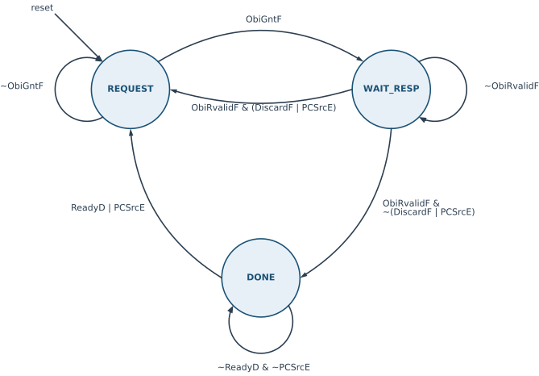

# Instruction fetch unit {#sec-ifu .unnumbered}

## Goal for this week

- Know what the instruction fetch unit (IFU) does, and which other parts of
  the core it talks to
- Read the IFU interface: the handshake to Decode, the redirect from
  Execute, and the OBI port to instruction memory
- Build the IFU datapath from generic blocks: `flopenr`, `mux2` and `adder`
- Design the IFU controller as an FSM: states, transitions, the discard
  flag and the outputs

## Introduction

::: {.content-visible when-format="revealjs"}
- Before an instruction executes, it must be **fetched** from memory
- The **program counter** (PC) says which instruction to fetch
- What the IFU needs:
  - two registers: the PC and the fetched instruction
  - an adder: `PC + 4`
  - a multiplexer: the next PC, sequential or a jump target
  - a port to instruction memory
  - a controller that steers it all
:::

::: {.content-visible unless-format="revealjs"}
The instruction fetch unit is the first stage of the HIPV pipeline (see the
overview in the [previous chapter](06-pipeline-structure.qmd)). Before
the core can execute an instruction, it must fetch it from memory, and which
instruction it fetches is determined by the **program counter** (PC), the
register that holds the address of the current instruction. RISC-V
instructions are 32 bits wide, four bytes, so without jumps the program
counter advances by four after every instruction.

To do this job, the IFU needs five things:

- two **registers**, one that holds the PC and one that holds the fetched
  instruction;
- an **adder** that computes the address of the next instruction, `PC + 4`;
- a **multiplexer** that chooses the next PC: the sequential `PC + 4`, or
  the target of a jump or taken branch;
- a **port to the instruction memory**, through which it sends the address
  and receives the instruction;
- a **controller** that decides when each register is loaded, when a
  request goes to memory, and when the fetched instruction is ready for the
  next stage.

The first four form the datapath, and they are built from the generic
blocks of the chapter on [designing with SystemVerilog](05-sv-design.qmd).
The controller is a finite state machine, and it is where most of the
thinking in this chapter goes.
:::

## Interface of the IFU

::: {.content-visible when-format="revealjs"}
| Group | Signals |
|---|---|
| Handshake with Decode | `ValidF` (out), `ReadyD` (in) |
| Redirect from Execute | `PCSrcE`, `PCTargetE` (in) |
| Stage outputs | `InstrF`, `PCF`, `PCPlus4F` (out) |
| Instruction memory (OBI) | `ObiReqF`, `ObiAddrF` (out); `ObiGntF`, `ObiRvalidF`, `ObiRdataF` (in) |
:::

::: {.content-visible unless-format="revealjs"}
The ports of the IFU fall into four groups: the handshake with the Decode
stage, the redirect from the Execute stage, the stage outputs, and the port
to the instruction memory. The suffix of every name says which stage the
signal belongs to: `F` for Fetch, `D` for Decode, `E` for Execute.

```systemverilog
module ifu (input  logic        clk, reset,
            // pipeline handshake and redirect
            input  logic        ReadyD,
            output logic        ValidF,
            input  logic        PCSrcE,
            input  logic [31:0] PCTargetE,
            // stage outputs to Decode
            output logic [31:0] InstrF,
            output logic [31:0] PCF, PCPlus4F,
            // OBI master port to instruction memory
            output logic        ObiReqF,
            input  logic        ObiGntF,
            output logic [31:0] ObiAddrF,
            input  logic        ObiRvalidF,
            input  logic [31:0] ObiRdataF);
```
:::

### Handshake with Decode

{#fig-ifu-handshake}

::: {.content-visible when-format="revealjs"}
- `ValidF`: the bits on `InstrF` are a fetched instruction, not leftovers
- `ReadyD`: Decode can accept a new instruction
- Transfer at the edge where **both** are 1
- `ValidF = 1`, `ReadyD = 0`: the IFU holds its outputs and waits
:::

::: {.content-visible unless-format="revealjs"}
The IFU and Decode work at their own pace, so they agree on each transfer
with two signals:

- `ValidF` (output) says that the output of the IFU is valid: the bits on
  `InstrF` are a fetched instruction, not leftovers from an earlier one or
  random bits after reset.
- `ReadyD` (input) says that Decode is ready to accept a new instruction.

An instruction moves from Fetch to Decode at a clock edge where both signals
are high. While `ValidF` is high and `ReadyD` is low, the IFU keeps its
outputs stable and waits. @fig-ifu-handshake shows both cases. Note that
`InstrF` itself does not tell whether it is valid: between cycles 7 and 9 it
still holds `I0`, which has already been handed over, and only `ValidF = 0`
tells Decode to ignore it. The same pair of signals connects every two
neighbouring stages of HIPV, which is why the pipeline is called *elastic*:
a slow stage simply holds back the stages in front of it.
:::

### Redirect from Execute

::: {.content-visible when-format="revealjs"}
- `PCSrcE`: 1 = a jump or taken branch, load the PC with the target
- `PCTargetE`: the 32-bit target address
- Both come from Execute, where the branch is resolved
- `PCSrcE` is a **one-cycle pulse**
:::

::: {.content-visible unless-format="revealjs"}
Jumps and branches are resolved in the Execute stage, and Execute tells the
IFU about them with two signals:

- `PCSrcE` is one bit: 1 means that a jump or a taken branch has occurred,
  so the next PC is the target; 0 means normal, sequential execution.
- `PCTargetE` is the 32-bit target address.

`PCSrcE` lasts exactly one clock cycle. In HIPV it is
`ValidEReg & ReadyM & (JumpE | JalrE | (BranchE & TakenE))`: it is high
only in the cycle in which the branch leaves Execute. In that same cycle the
instruction in Decode is flushed (its valid bit is gated with `~PCSrcE`), so
in the next cycle Execute holds a bubble and `PCSrcE` drops back to 0. The
IFU must therefore react to the redirect in the cycle it sees it. It cannot
look at `PCSrcE` again later, which is the root of the discard flag
(@sec-ifu-discard).
:::

### Stage outputs

::: {.content-visible when-format="revealjs"}
- `InstrF`: the fetched instruction
- `PCF`: the address it was fetched from
- `PCPlus4F`: `PCF + 4`
- PC values travel down the pipeline: branch targets, `jal`/`jalr`,
  `auipc`
:::

::: {.content-visible unless-format="revealjs"}
The IFU hands three values to Decode:

- `InstrF`, the fetched instruction;
- `PCF`, the address the instruction was fetched from;
- `PCPlus4F`, the address of the next instruction, `PCF + 4`.

The two PC values are not needed in the IFU, but in later stages. Execute
adds an offset to `PCF` to compute the target of a branch or of `jal`, and
`auipc` adds an immediate to it. `PCPlus4F` is the return address that
`jal` and `jalr` write into the destination register. Both travel down the
pipeline together with their instruction.
:::

### Port to instruction memory

{#fig-ifu-obi}

::: {.content-visible when-format="revealjs"}
- OBI protocol, read only; details [later in the
  semester](https://laspp.github.io/digital_design/22-OBI.html)
- **Address phase**: `ObiReqF` + `ObiAddrF` until `ObiGntF`
- **Response phase**: `ObiRvalidF` + `ObiRdataF`, at least one cycle later
- The memory decides when: grant and response can take any number of cycles
:::

::: {.content-visible unless-format="revealjs"}
The IFU reads instructions over the OBI (Open Bus Interface) protocol, which
we discuss in detail [later in the
semester](https://laspp.github.io/digital_design/22-OBI.html). For now, a
simplified view is enough. The IFU only reads, so it uses five signals:

| Signal | Direction | Meaning |
|---|---|---|
| `ObiReqF` | out | request: the IFU wants to start a read |
| `ObiAddrF` | out | address of the location to read |
| `ObiGntF` | in | grant: the memory has accepted the request |
| `ObiRvalidF` | in | response valid: `ObiRdataF` carries the read data |
| `ObiRdataF` | in | the data read, here an instruction |

Each read, or *transaction*, has two phases (@fig-ifu-obi). In the
**address phase**, the IFU raises `ObiReqF` and puts the address on
`ObiAddrF`, and keeps both until the memory answers with `ObiGntF`. At the
edge where `ObiReqF` and `ObiGntF` are both high, the memory has taken the
address. This is the same valid/ready idea as the handshake with Decode. In
the **response phase**, at least one cycle after the grant, the memory
raises `ObiRvalidF` for one cycle, and in that cycle `ObiRdataF` holds the
instruction. Outside that cycle, `ObiRdataF` is meaningless.

The memory decides how long each phase takes. In @fig-ifu-obi it grants
after one wait cycle and responds one cycle after the grant, but a slower
memory may need more cycles for either. Two properties are important for
the controller. First, once the request is granted, the response *will*
come, and the protocol has no way of cancelling it. Second, a response
carries no tag that says which request it belongs to: responses come back
in the order of the requests. HIPV keeps at most one transaction in flight
at a time, so the response always belongs to the last granted request.
:::

## Structure of the IFU

{#fig-ifu}

::: {.content-visible when-format="revealjs"}
- **PC loop**: `pcmux` chooses the next PC, `pcreg` holds it (enable
  `PCEnF`), `pcadd4` computes `PC + 4`
- **Instruction register**: `instrreg` holds the instruction (enable
  `InstrEnF`)
- **Controller** `ifuctrl`: the enables, the memory request, `ValidF`
- `ObiAddrF = PCF`
:::

::: {.content-visible unless-format="revealjs"}
@fig-ifu shows the IFU. It has three parts.

The **PC loop** updates the program counter. The multiplexer `pcmux` chooses
the next PC, `PCNextF`: the sequential `PCPlus4F` when `PCSrcE` is 0, and the
jump target `PCTargetE` when it is 1. The register `pcreg` holds the current
PC, `PCF`. It has an enable, `PCEnF`, driven by the controller, so the PC
changes only when the controller allows it. The adder `pcadd4` computes
`PCF + 4`. The current PC is also the address of the memory read, so
`ObiAddrF` is simply `PCF`.

The **instruction register** `instrreg` stores the fetched instruction. Its
input is the memory data `ObiRdataF`, and its enable, `InstrEnF`, is also
driven by the controller: the register must capture `ObiRdataF` in exactly
the cycle in which `ObiRvalidF` says that it is valid.

The **controller** `ifuctrl` manages the flow through the unit: it watches
the memory, Decode and Execute, and drives the two enables, the memory
request and `ValidF`. It is the subject of @sec-ifu-ctrl.
:::

### The building blocks

::: {.content-visible when-format="revealjs"}
```systemverilog
module flopenr #(parameter WIDTH = 8) (
  input  logic             clk, reset, en,
  input  logic [WIDTH-1:0] D,
  output logic [WIDTH-1:0] Q);

  always_ff @(posedge clk)
    if (reset) Q <= '0;
    else if (en) Q <= D;

endmodule

module mux2 #(parameter WIDTH = 8) (
  input  logic [WIDTH-1:0] D0, D1,
  input  logic             S,
  output logic [WIDTH-1:0] Y);

  assign Y = S ? D1 : D0;

endmodule

module adder #(parameter WIDTH = 8) (
  input  logic [WIDTH-1:0] A, B,
  output logic [WIDTH-1:0] Y);

  assign Y = A + B;

endmodule
```
:::

::: {.content-visible unless-format="revealjs"}
The datapath uses three generic modules from `rtl/generic`, which we met in
the chapter on [designing with SystemVerilog](05-sv-design.qmd). All three
are parameterized by `WIDTH`, and the IFU uses them with 32 bits.

`flopenr` is a register with a synchronous reset and an enable. At a rising
edge it clears to zero if `reset` is high, otherwise it loads `D` if `en` is
high, and otherwise it keeps its value. The missing `else` branch is what
makes it hold. The reset value zero is also the reset vector of HIPV: after
reset, the first instruction is fetched from address 0.

```systemverilog
module flopenr #(parameter WIDTH = 8) (
  input  logic             clk, reset, en,
  input  logic [WIDTH-1:0] D,
  output logic [WIDTH-1:0] Q);

  always_ff @(posedge clk)
    if (reset) Q <= '0;
    else if (en) Q <= D;

endmodule
```

`mux2` is a two-input multiplexer: `Y` is `D1` when `S` is 1 and `D0` when it
is 0. It is purely combinational, one continuous assignment with the
conditional operator.

```systemverilog
module mux2 #(parameter WIDTH = 8) (
  input  logic [WIDTH-1:0] D0, D1,
  input  logic             S,
  output logic [WIDTH-1:0] Y);

  assign Y = S ? D1 : D0;

endmodule
```

`adder` adds two numbers. The result has the same width as the operands,
so the carry out is dropped. For the PC this is the intended behavior: the
address wraps around from `0xFFFFFFFC` to 0.

```systemverilog
module adder #(parameter WIDTH = 8) (
  input  logic [WIDTH-1:0] A, B,
  output logic [WIDTH-1:0] Y);

  assign Y = A + B;

endmodule
```
:::

### The IFU in SystemVerilog

::: {.content-visible when-format="revealjs"}
```systemverilog
  logic [31:0] PCNextF;
  logic        PCEnF, InstrEnF;

  ifuctrl ctrl(.clk(clk), .reset(reset), .ObiGntF(ObiGntF),
               .ObiRvalidF(ObiRvalidF), .ReadyD(ReadyD),
               .PCSrcE(PCSrcE), .ObiReqF(ObiReqF), .PCEnF(PCEnF),
               .InstrEnF(InstrEnF), .ValidF(ValidF));

  mux2 #(32)    pcmux(.D0(PCPlus4F), .D1(PCTargetE), .S(PCSrcE), .Y(PCNextF));
  flopenr #(32) pcreg(.clk(clk), .reset(reset), .en(PCEnF), .D(PCNextF), .Q(PCF));
  adder #(32)   pcadd4(.A(PCF), .B(32'd4), .Y(PCPlus4F));
  flopenr #(32) instrreg(.clk(clk), .reset(reset), .en(InstrEnF),
                         .D(ObiRdataF), .Q(InstrF));

  assign ObiAddrF = PCF;
```
:::

::: {.content-visible unless-format="revealjs"}
The body of `ifu` is purely structural: it is @fig-ifu written as code, one
instance per block, with the ports connected by name. The only internal
signals are the next PC and the two enables.

```systemverilog
  logic [31:0] PCNextF;
  logic        PCEnF, InstrEnF;

  // fetch control FSM
  ifuctrl ctrl(.clk(clk), .reset(reset), .ObiGntF(ObiGntF), .ObiRvalidF(ObiRvalidF),
               .ReadyD(ReadyD), .PCSrcE(PCSrcE), .ObiReqF(ObiReqF), .PCEnF(PCEnF),
               .InstrEnF(InstrEnF), .ValidF(ValidF));

  // next PC selection: sequential or redirect from Execute
  mux2 #(32)    pcmux(.D0(PCPlus4F), .D1(PCTargetE), .S(PCSrcE), .Y(PCNextF));

  // PC register
  flopenr #(32) pcreg(.clk(clk), .reset(reset), .en(PCEnF), .D(PCNextF), .Q(PCF));

  // sequential PC
  adder #(32)   pcadd4(.A(PCF), .B(32'd4), .Y(PCPlus4F));

  // fetched instruction register
  flopenr #(32) instrreg(.clk(clk), .reset(reset), .en(InstrEnF), .D(ObiRdataF), .Q(InstrF));

  // the OBI address is the current PC
  assign ObiAddrF = PCF;
```

Note that the select of `pcmux` is `PCSrcE` directly, not a signal of the
controller. The controller only decides *when* the PC changes, through
`PCEnF`, and the multiplexer decides *to what*.
:::

## The IFU controller {#sec-ifu-ctrl}

::: {.content-visible when-format="revealjs"}
- Three tasks:
  1. drive the enables `PCEnF` and `InstrEnF`
  2. issue memory requests: `ObiReqF`
  3. tell Decode that an instruction is ready: `ValidF`
- Why a controller at all?
  - a fetch takes **several cycles**: watch `ObiGntF` and `ObiRvalidF`
  - a **jump** restarts the fetch, and may make an instruction in flight
    useless
  - Decode may **not be ready**: freeze until it is
:::

::: {.content-visible unless-format="revealjs"}
The controller `ifuctrl` manages the flow of instructions through the IFU.
It has three tasks:

1. generate the internal enables `InstrEnF` and `PCEnF`, which decide when
   the instruction register and the PC register are loaded;
2. issue the memory requests through the OBI port, with `ObiReqF`;
3. tell Decode that the IFU has finished fetching an instruction, with
   `ValidF`.

Why do we need a controller at all, when the datapath looks so simple? For
three reasons. First, fetching an instruction does not happen in one cycle.
The memory needs time to grant the request and more time to respond, and
the controller must watch `ObiGntF` and `ObiRvalidF` to know where the
transaction is. Second, a jump can arrive at any time. The IFU must then
restart fetching from the new address and, if an instruction from the old
address is still on its way from memory, throw it away when it arrives.
Third, Decode may not be ready to accept the instruction, and then the IFU
must freeze, with its outputs stable, until it is.

All three depend on what has happened before: whether a request has been
granted, whether an instruction has arrived, whether it has been handed
over. The controller must remember this, so it is a finite state machine.
:::

### The states

{#fig-ifuctrl-fsm width=75%}

::: {.content-visible when-format="revealjs"}
```systemverilog
typedef enum logic [1:0] {REQUEST, WAIT_RESP, DONE} statetype;

statetype State, NextState;
logic     DiscardF, NextDiscardF;
```

- `REQUEST`: start a fetch, wait for the grant
- `WAIT_RESP`: wait for the instruction to arrive
- `DONE`: hold the instruction until Decode takes it
:::

::: {.content-visible unless-format="revealjs"}
A fetch goes through three steps, and each becomes a state:

- `REQUEST`: the IFU initiates the fetch. It sends a request to the memory
  and waits for the memory to accept it.
- `WAIT_RESP`: the request has been accepted, and the IFU waits for the
  response, the instruction.
- `DONE`: the instruction has arrived and sits in the instruction register.
  The IFU offers it to Decode and waits until Decode takes it.

In SystemVerilog, the states are an enumerated type, encoded in two bits.
Following the FSM pattern of the [previous chapter](05b-fsm.qmd), the
controller has a current-state and a next-state signal. It also has a second
current/next pair, `DiscardF` and `NextDiscardF`, which we explain next.

```systemverilog
typedef enum logic [1:0] {REQUEST, WAIT_RESP, DONE} statetype;

statetype State, NextState;
logic     DiscardF, NextDiscardF;
```

@fig-ifuctrl-fsm shows the states and the transitions between them. The
following sections derive the transitions one state at a time.
:::

### The discard flag {#sec-ifu-discard}

::: {.content-visible when-format="revealjs"}
- A jump while a request is **granted but not answered**
  - the response *will* come, and it holds the **wrong** instruction
  - `PCSrcE` lasts one cycle, the response may come many cycles later
- `DiscardF` = 1: "the response I am waiting for is stale"
- Set: `PCSrcE` while a transaction is outstanding
- Cleared: when the stale response arrives, and is dropped
:::

::: {.content-visible unless-format="revealjs"}
Besides the state, the controller keeps one more bit, `DiscardF`, a pending
request to discard the instruction that is on its way. Consider a jump that
arrives after the memory has granted a request, but before it has responded.
The response will come, because a granted transaction cannot be cancelled,
and it will carry the instruction from the old address, which is now on the
wrong path. The IFU must not hand that instruction to Decode, and it must
not start the fetch from the new address before the stale response has
arrived. Otherwise it would take the stale response as the answer to the
new request, since responses carry no tag.

The difficulty is time. `PCSrcE` is high for a single cycle, but on a slow
memory the stale response may arrive many cycles later, when `PCSrcE` is
long gone. So the controller needs one bit of memory that says "the
response I am waiting for belongs to the wrong path": `DiscardF`. It is set
when `PCSrcE` arrives while a transaction is outstanding, which is in
`WAIT_RESP`, or in `REQUEST` in the very cycle the grant arrives. It is
cleared when the awaited response arrives, and that response is dropped
instead of captured.
:::

### Transitions

{#fig-ifuctrl-asm}

::: {.content-visible when-format="revealjs"}
- `REQUEST`: wait for `ObiGntF`; a jump in the same cycle sets `DiscardF`
- `WAIT_RESP`, no `ObiRvalidF`: wait; a jump sets `DiscardF`
- `WAIT_RESP`, `ObiRvalidF`:
  - `DiscardF | PCSrcE`: drop it, clear `DiscardF`, back to `REQUEST`
  - otherwise: `DONE`
- `DONE`: `ReadyD | PCSrcE` → `REQUEST`, otherwise stay
:::

::: {.content-visible unless-format="revealjs"}
@fig-ifuctrl-asm shows the transitions as an ASM chart, one column per
state, together with the updates of `DiscardF` in the rounded conditional
boxes. Let us go through it state by state.

**From `REQUEST`.** First, we ask whether the memory has accepted our
request, by checking `ObiGntF`. If not, we stay in `REQUEST` and keep
asking. If it has, the transaction is committed and we move to `WAIT_RESP`.
Before we go, we check whether a jump has occurred in this same cycle
(`PCSrcE`). If so, the response that will come belongs to the old PC, and we
raise `DiscardF` to 1. A jump in `REQUEST` without the grant needs no flag:
nothing has been committed yet, the PC is loaded with the target in this
cycle, and the request simply continues with the new address.

**From `WAIT_RESP`.** First, we ask whether the instruction has arrived from
memory, by checking `ObiRvalidF`. If not, we keep waiting in `WAIT_RESP`.
While we wait, a jump may occur, so we check `PCSrcE` and, if it is 1, raise
`DiscardF`: the response we are waiting for is now stale. If the instruction
has arrived, we check whether we must discard it, by reading `DiscardF` and
`PCSrcE`. `DiscardF` covers a jump in an earlier cycle, and `PCSrcE` a jump
in this very cycle. If either is 1, we drop the instruction, clear the
pending discard, and restart the fetch by moving to `REQUEST`. Otherwise, the
instruction is good, and we proceed to `DONE`.

**From `DONE`.** We have the instruction, and now we must finish with it.
There are two ways out. In the normal one, `ReadyD` is 1: Decode takes the
instruction, and we can fetch the next one. In the other, a jump has
occurred, the instruction we hold is on the wrong path, and we must restart
the fetch from the target. If either condition is met, we move to
`REQUEST`; otherwise we stay in `DONE`. No transaction is outstanding in
`DONE`, so `DiscardF` does not change here.

The flag is cleared only in `WAIT_RESP`, because that is the only state in
which a response can arrive. On the path to `DONE`, the flag is already 0,
so no box is needed there.
:::

### The controller in SystemVerilog

::: {.content-visible when-format="revealjs"}
```systemverilog
  // state register
  always_ff @(posedge clk)
    if (reset) begin
      State    <= REQUEST;
      DiscardF <= 1'b0;
    end else begin
      State    <= NextState;
      DiscardF <= NextDiscardF;
    end

  // next state logic
  always_comb begin
    NextState    = State;  // defaults: hold
    NextDiscardF = DiscardF;
    case (State)
      REQUEST:   begin NextState    = ObiGntF ? WAIT_RESP : REQUEST;
                       NextDiscardF = ObiGntF & PCSrcE; end
      WAIT_RESP: if (ObiRvalidF) begin NextState    = (DiscardF | PCSrcE) ? REQUEST : DONE;
                                       NextDiscardF = 1'b0; end
                 else NextDiscardF = DiscardF | PCSrcE;
      DONE:      if (PCSrcE | ReadyD) NextState = REQUEST;
      default:   NextState = REQUEST;
    endcase
  end
```
:::

::: {.content-visible unless-format="revealjs"}
The code follows the chart column by column. `State` and `DiscardF` are
updated in the same register block, with a synchronous reset to `REQUEST`
and no pending discard:

```systemverilog
  // state register
  always_ff @(posedge clk)
    if (reset) begin
      State    <= REQUEST;
      DiscardF <= 1'b0;
    end else begin
      State    <= NextState;
      DiscardF <= NextDiscardF;
    end
```

The next-state logic computes both next values in one `always_comb` block.
It starts with the defaults, hold the state and hold the flag, and each
branch of the `case` overrides only what changes:

```systemverilog
  // next state logic
  always_comb begin
    NextState    = State;  // defaults: hold
    NextDiscardF = DiscardF;
    case (State)
      // the grant commits the transaction on this edge, so a redirect
      // in the same cycle already has a wrong-path response coming
      REQUEST:   begin NextState    = ObiGntF ? WAIT_RESP : REQUEST;
                       NextDiscardF = ObiGntF & PCSrcE; end
      // the awaited response clears the flag; with no response yet, a
      // redirect makes the outstanding one stale
      WAIT_RESP: if (ObiRvalidF) begin NextState    = (DiscardF | PCSrcE) ? REQUEST : DONE;
                                       NextDiscardF = 1'b0; end
                 else NextDiscardF = DiscardF | PCSrcE;
      DONE:      if (PCSrcE | ReadyD) NextState = REQUEST;
      default:   NextState = REQUEST;
    endcase
  end
```

Keeping `DiscardF` in the same current/next pattern as `State` matters in
`WAIT_RESP`. When the response arrives, the decision
`(DiscardF | PCSrcE)` reads the *current* `DiscardF`, while the clear goes
to `NextDiscardF` and only takes effect at the next edge. The flag is
therefore still valid in the cycle in which the stale response is
examined. In `REQUEST` the flag is always 0, so
`NextDiscardF = ObiGntF & PCSrcE` is the same as "set it on a jump in the
cycle of the grant".
:::

{#fig-ifuctrl-discard}

::: {.content-visible when-format="revealjs"}
- `outstanding` = `WAIT_RESP`, or `REQUEST & ObiGntF`
- `PCSrcE & outstanding` → 1
- `ObiRvalidF` → 0 (has priority)
- otherwise hold
:::

::: {.content-visible unless-format="revealjs"}
@fig-ifuctrl-discard shows what the `DiscardF` lines become in hardware:
one flip-flop and two multiplexers. The first sets the flag when `PCSrcE`
arrives while a transaction is outstanding; the second, which has priority,
clears it when the response arrives. If neither applies, the flip-flop gets
its own output back, and holds.
:::

### The outputs

::: {.content-visible when-format="revealjs"}
```systemverilog
  assign ObiReqF  = (State == REQUEST);
  assign PCEnF    = PCSrcE | ((State == DONE) & ReadyD);
  assign InstrEnF = (State == WAIT_RESP) & ObiRvalidF & ~DiscardF & ~PCSrcE;
  assign ValidF   = (State == DONE) & ~PCSrcE;
```

- `ObiReqF`: Moore, only the state
- the others: Mealy, they react to the inputs in the same cycle
:::

::: {.content-visible unless-format="revealjs"}
The four outputs are combinational functions of the state, the flag and
the inputs:

```systemverilog
  // outputs
  assign ObiReqF  = (State == REQUEST);
  assign PCEnF    = PCSrcE | ((State == DONE) & ReadyD);
  assign InstrEnF = (State == WAIT_RESP) & ObiRvalidF & ~DiscardF & ~PCSrcE;
  assign ValidF   = (State == DONE) & ~PCSrcE;
```

- `ObiReqF` is high in `REQUEST`. It depends only on the state, so it is a
  Moore output. The request stays high until the grant moves the FSM to
  `WAIT_RESP`, exactly as the OBI address phase requires.
- `PCEnF` lets the PC change in two cases. On a jump, the PC loads the
  target immediately, in any state, because `pcmux` selects `PCTargetE`
  whenever `PCSrcE` is 1. In `DONE`, when Decode takes the instruction
  (`ReadyD`), the PC advances to `PCPlus4F`. The PC must not advance
  earlier, because `PCF` is a stage output that belongs to the instruction
  that Decode has not taken yet.
- `InstrEnF` loads the instruction register in the cycle the response
  arrives (`WAIT_RESP` and `ObiRvalidF`), unless the response is stale
  (`DiscardF`) or a jump arrives in the same cycle (`PCSrcE`). Both are
  exactly the conditions under which the FSM returns to `REQUEST` instead
  of going to `DONE`.
- `ValidF` is high in `DONE`, while the instruction waits for Decode. A jump
  turns it off at once, in the same cycle, so that Decode never takes an
  instruction from the wrong path.

All outputs except `ObiReqF` also depend on the inputs, so they are Mealy
outputs: they react in the same cycle, without waiting for a state change.
That is what lets the IFU take a jump in the very cycle `PCSrcE` is high.
:::

### The controller in the waveform

{#fig-ifu-fetch}

::: {.content-visible when-format="revealjs"}
- One fetch = `REQUEST` → `WAIT_RESP` → `DONE`
- At least **3 cycles per instruction**, even with an ideal memory
- `ReadyD = 0` stretches `DONE`; the PC waits too
:::

::: {.content-visible unless-format="revealjs"}
@fig-ifu-fetch shows the controller at work, on a memory that grants after
one wait cycle and responds one cycle after the grant. In cycle 2 the grant
arrives, and the FSM moves to `WAIT_RESP`. In cycle 3 the response arrives;
`InstrEnF` is high, so at the end of the cycle the instruction register
captures `I0`, and the FSM moves to `DONE`. From cycle 4, `ValidF` offers
`I0` to Decode, but Decode is busy for two cycles. In cycle 6 `ReadyD`
rises, `PCEnF` follows it, and at the end of the cycle the PC advances to
`0x4` and the FSM starts the next fetch.

Each instruction spends at least one cycle in each state, so the IFU fetches
at most one instruction every three cycles, even with an ideal memory that
grants at once. This is a deliberate simplification that keeps the
controller small. A faster IFU would issue the next request before the
previous response arrives, and keep the extra instructions in a small
buffer.
:::

{#fig-ifu-discard}

::: {.content-visible when-format="revealjs"}
- Cycle 2: `PCSrcE` in `WAIT_RESP` → `DiscardF = 1`, `PCF = T`
- Cycle 4: `I(A)` arrives, `InstrEnF = 0`, `DiscardF` cleared, back to
  `REQUEST`
- Cycles 5–9: a normal fetch from `T`
- Without `DiscardF`: `I(A)` would reach Decode with `PCF = T`
:::

::: {.content-visible unless-format="revealjs"}
@fig-ifu-discard shows the discard flag at work, on a memory that takes
three cycles to respond. In cycle 1 the request for address `A` is granted.
In cycle 2, while the IFU waits for the response, Execute resolves a jump to
`T`: `PCSrcE` is high, so `PCEnF` loads `T` into the PC, and `NextDiscardF`
is 1. In cycle 4 the response for `A` arrives. `DiscardF` is 1, so
`InstrEnF` stays low, the instruction register keeps its old value, and the
FSM returns to `REQUEST` while the flag clears. From cycle 5 on, the IFU
fetches from `T` as usual, and in cycle 9 it offers `I(T)` to Decode.

Without the flag, the FSM in cycle 4 would capture `I(A)` and offer it to
Decode together with `PCF = T`: the wrong instruction, with the address of
another one.
:::

## Summary

::: {.content-visible when-format="revealjs"}
- Datapath: PC loop + instruction register, from generic blocks
- Controller: 3 states, 1 discard flag
- `PCSrcE` lasts one cycle, so the IFU must remember a pending discard
- Simplifications: one transaction at a time (3 cycles per instruction);
  a jump during `REQUEST` changes `ObiAddrF` before the grant
:::

::: {.content-visible unless-format="revealjs"}
The IFU is a small datapath, the PC loop and the instruction register,
built from the generic blocks `flopenr`, `mux2` and `adder`, and a
controller that decides when each of them acts. The controller is a
three-state FSM with one extra bit of memory, the discard flag, which
remembers a jump for as long as a stale instruction is on its way from
memory.

The design makes two deliberate simplifications. It keeps one memory
transaction in flight at a time, which limits it to one instruction every
three cycles. And a jump in `REQUEST`, before the grant, changes
`ObiAddrF` while `ObiReqF` is high. Strict OBI requires the address to
stay stable during the address phase, but simple memories, which take the
address only in the cycle of the grant, tolerate the change. Both are natural extensions for
later in the course.
:::
