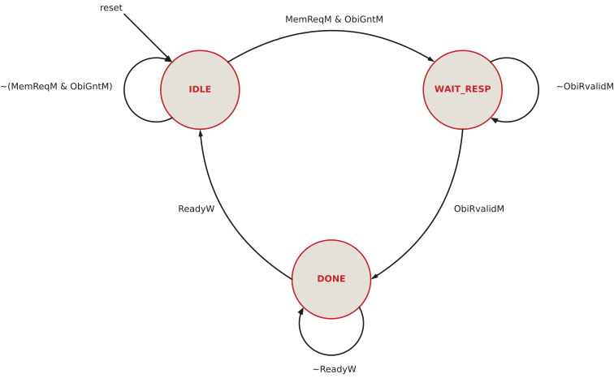

# Load/store unit {#sec-lsu .unnumbered}

## Goal for this week

- Know what the load/store unit (LSU) does, and how it differs from the
  stages before it
- Read the LSU interface, in particular the OBI signals for writing to
  memory
- Understand how the stage holds a memory instruction until its
  transaction is finished
- Design the LSU controller as an FSM, and process the data of byte and
  halfword accesses

## Introduction

::: {.content-visible when-format="revealjs"}
- Fourth stage of HIPV: the **Memory stage**
- Same building blocks as before: handshake, pipeline registers, FSM
- Its job: memory access for **loads and stores**
  - talks to data memory over **OBI**, like the IFU
  - unlike the IFU, it also **writes** (stores)
  - only loads and stores use memory; everything else **passes through**
    in one cycle
  - forwards its result **back to Execute**
:::

::: {.content-visible unless-format="revealjs"}
The load/store unit is the fourth stage of the HIPV pipeline, the Memory
stage. Its design closely resembles the stages we have seen so far: it has
the same valid/ready handshake, the same kind of pipeline registers, and,
like the IFU, an FSM that talks to a memory. What is new is mostly what it
does with the memory.

The role of the LSU is to give the core access to the data memory, for the
load and store instructions. That gives it four properties:

- It communicates with the data memory through the **OBI** interface, the
  same protocol the IFU uses for the instruction memory.
- Unlike the IFU, which only reads instructions, the LSU also **writes**
  to memory, for the store instructions, alongside **reading** for the
  loads.
- It does **not** need to access memory all the time. Only loads and
  stores use the memory. Every other instruction, an `add` or a `jal`, just
  passes through the stage to Writeback, in a single cycle.
- It **forwards** its result back to the Execute stage, so that the next
  instruction can use it before it reaches the register file.
:::

## Interface of the LSU

::: {.content-visible when-format="revealjs"}
| Group | Signals |
|---|---|
| Handshake with Execute | `ValidE` (in), `ReadyM` (out) |
| From Execute | `ALUResultE`, `WriteDataE`, `PCPlus4E`, `RdE`, `Funct3E`, controls |
| Handshake with Writeback | `ValidM` (out), `ReadyW` (in) |
| To Writeback | `ALUResultM`, `ReadDataM`, `PCPlus4M`, `RdM`, `RegWriteM`, `ResultSrcM` |
| Forwarding to Execute | `ForwardDataM` (out) |
| Data memory (OBI) | `ObiReqM`, `ObiAddrM`, `ObiWeM`, `ObiBeM`, `ObiWdataM` (out); `ObiGntM`, `ObiRvalidM`, `ObiRdataM` (in) |
:::

::: {.content-visible unless-format="revealjs"}
The ports of the LSU fall into six groups:

```systemverilog
module lsu (input  logic        clk, reset,
            // handshake with the Execute stage
            input  logic        ValidE,
            output logic        ReadyM,
            // inputs from Execute
            input  logic [31:0] ALUResultE, WriteDataE, PCPlus4E,
            input  logic [4:0]  RdE,
            input  logic [2:0]  Funct3E,
            input  logic        RegWriteE, MemWriteE,
            input  logic [1:0]  ResultSrcE,
            // handshake with the Writeback stage
            output logic        ValidM,
            input  logic        ReadyW,
            // stage outputs to Writeback
            output logic [31:0] ALUResultM, ReadDataM, PCPlus4M,
            output logic [4:0]  RdM,
            output logic        RegWriteM,
            output logic [1:0]  ResultSrcM,
            // forwarding to Execute
            output logic [31:0] ForwardDataM,
            // OBI master port to data memory
            output logic        ObiReqM,
            input  logic        ObiGntM,
            output logic [31:0] ObiAddrM,
            output logic        ObiWeM,
            output logic [3:0]  ObiBeM,
            output logic [31:0] ObiWdataM,
            input  logic        ObiRvalidM,
            input  logic [31:0] ObiRdataM);
```

- **Handshake with Execute**: `ValidE` and `ReadyM`.
- **Inputs from Execute**: `ALUResultE`, which is the address for a load
  or store and the result for any other instruction; `WriteDataE`, the data
  a store writes; `PCPlus4E`, the return address of `jal` and `jalr`; the
  destination register `RdE`; `Funct3E`, which gives the size of the access;
  and the controls `RegWriteE`, `MemWriteE` and `ResultSrcE`.
- **Handshake with Writeback**: `ValidM` and `ReadyW`.
- **Outputs to Writeback**: the three candidate results (`ALUResultM`,
  the loaded data `ReadDataM`, and `PCPlus4M`), the destination register
  `RdM`, the write enable `RegWriteM`, and `ResultSrcM`, which tells
  Writeback which of the three results to write.
- **Forwarding to Execute**: `ForwardDataM`, the result of the instruction
  in this stage.
- **OBI port to the data memory**, described in @sec-lsu-obi.
:::

## Structure of the LSU

{#fig-lsu}

::: {.content-visible when-format="revealjs"}
- **Handshake logic**: holds a memory instruction until it is done
- **E/M pipeline registers**
- **FSM** `lsuctrl`: runs one OBI transaction
- **OBI signals**: address, byte enables, store data
- **Load processing**: `rawreg`, shift, sign/zero extension
- **Forwarding**: `ForwardDataM` to Execute, results to Writeback
:::

::: {.content-visible unless-format="revealjs"}
@fig-lsu shows the LSU. It has six parts, and the rest of the chapter takes
them in this order:

1. the **handshake logic**, which accepts instructions from Execute and,
   for a memory instruction, holds it in the stage until the memory access
   is finished;
2. the **E/M pipeline registers**;
3. the **FSM** `lsuctrl`, which runs the OBI transaction;
4. the logic that generates the **OBI signals**: the word address, the
   byte enables and the store data;
5. the **post-processing of loaded data**: the register `rawreg`, which
   captures the word from memory, followed by a shift and a sign or zero
   extension;
6. the **forwarding** of the result to Execute, and the outputs to
   Writeback.
:::

## Handshake logic {#sec-lsu-handshake}

::: {.content-visible when-format="revealjs"}
```systemverilog
  // E/M handshake: a memory instruction holds the stage until done
  assign MemOpM = MemWriteM | (ResultSrcM == RESULT_MEM);
  assign ValidM = ValidMReg & (~MemOpM | DoneM);
  assign ReadyM = ~ValidMReg | (ValidM & ReadyW);
  assign EnEM   = ValidE & ReadyM;

  // E/M valid bit
  always_ff @(posedge clk)
    if (reset) ValidMReg <= 1'b0;
    else if (ReadyM) ValidMReg <= ValidE;
```
:::

::: {.content-visible unless-format="revealjs"}
The handshake logic of the LSU has the same shape as in Decode and Execute,
with one addition: a memory instruction cannot be handed on until its
memory access is finished.

```systemverilog
  // E/M handshake: a memory instruction holds the stage until done
  assign MemOpM = MemWriteM | (ResultSrcM == RESULT_MEM);
  assign ValidM = ValidMReg & (~MemOpM | DoneM);
  assign ReadyM = ~ValidMReg | (ValidM & ReadyW);
  assign EnEM   = ValidE & ReadyM;

  // E/M valid bit
  always_ff @(posedge clk)
    if (reset) ValidMReg <= 1'b0;
    else if (ReadyM) ValidMReg <= ValidE;
```

**`EnEM`** is the handshake between Execute and the LSU: Execute offers an
instruction (`ValidE`) and the LSU accepts it (`ReadyM`). As in the other
stages, it enables the pipeline registers, so it is the moment the
instruction enters the Memory stage.
:::

### When is the output valid?

::: {.content-visible when-format="revealjs"}
```systemverilog
  assign ValidM = ValidMReg & (~MemOpM | DoneM);
```

- `ValidMReg`: the stage holds a valid instruction
- `~MemOpM`: not a load or store: pass through **at once**
- `DoneM`: a load or store whose transaction **is finished**
- `MemOpM = MemWriteM | (ResultSrcM == RESULT_MEM)`
  - `MemWriteM`: a store
  - `ResultSrcM == RESULT_MEM`: the result comes from memory: a load
:::

::: {.content-visible unless-format="revealjs"}
In Decode and Execute, the output was valid as soon as the stage held a
valid instruction. The LSU adds a condition:

```systemverilog
  assign ValidM = ValidMReg & (~MemOpM | DoneM);
```

The output is valid when the stage holds a valid instruction, **and**
either it is not a memory instruction, or its memory transaction is done.
The three terms:

- **`ValidMReg`** is the valid bit of the stage. It says that the stage
  holds a valid instruction and not a bubble.
- **`~MemOpM`** says that the instruction is neither a load nor a store.
  Such an instruction has nothing to do here, so it is handed on to
  Writeback in the same cycle, without waiting for anything.
- **`DoneM`** says that the memory transaction of a load or store is
  finished. It is generated by the FSM (@sec-lsu-fsm). Until it is 1, a
  memory instruction is not offered to Writeback.

How does the LSU know that it holds a memory instruction? From two controls
that Decode generated, and that have travelled with the instruction through
the pipeline registers:

```systemverilog
  assign MemOpM = MemWriteM | (ResultSrcM == RESULT_MEM);
```

- `MemWriteM`, the copy of `MemWriteE` in the E/M register, is 1 for a
  store.
- `ResultSrcM` says which value Writeback will write into the register
  file. `RESULT_MEM` means that this value is the data read from memory,
  and only a load writes that. So `ResultSrcM == RESULT_MEM` identifies a
  load.

No separate "is a load" signal is needed: the two controls the later stages
need anyway already carry the information.
:::

::: {.callout-note}
## Reminder: why a valid *register*?

`ValidMReg` is a copy of `ValidE` delayed by one edge, loaded whenever the
stage can accept something (`ReadyM`). It must be a register, because the
valid bit has to move through the pipeline at the same pace as the
instruction it labels. After the edge, the instruction from Execute sits in
the E/M registers, and `ValidE` already describes the next one. Storing the
valid bit at the same edge, next to the data, keeps the label with its
instruction. The same holds for `ValidDReg` in Decode and `ValidEReg` in
Execute.
:::

### When can the stage accept?

::: {.content-visible when-format="revealjs"}
```systemverilog
  assign ReadyM = ~ValidMReg | (ValidM & ReadyW);
```

- `~ValidMReg`: the stage holds a **bubble**
- `ValidM & ReadyW`: the instruction is **drained** into Writeback at this
  edge
- A load waiting for memory: `ValidM = 0`, so `ReadyM = 0`
  - Execute, Decode and Fetch **stall** behind it
:::

::: {.content-visible unless-format="revealjs"}
`ReadyM` tells Execute that the LSU can accept a new instruction:

```systemverilog
  assign ReadyM = ~ValidMReg | (ValidM & ReadyW);
```

There are two cases:

- **`~ValidMReg`**: the stage holds a bubble, so there is nothing to lose.
- **`ValidM & ReadyW`**: the instruction in the stage is drained, handed
  over to Writeback at this very edge, so its place is free for the next
  one.

Compare this with Execute, where the second term was just `ReadyM`. Here it
includes `ValidM`, because a memory instruction that is still waiting for
its transaction cannot leave, even if Writeback is ready. While a load
waits for memory, `ValidM` is 0, so `ReadyM` is 0, and the stall propagates
backwards: Execute holds its instruction, Decode holds its, and Fetch stops.
This is the back-pressure that makes a separate load-use stall unnecessary
(see the refresh loop in the [IEU chapter](06d-ieu.qmd)).
:::

## E/M pipeline registers

::: {.content-visible when-format="revealjs"}
```systemverilog
  flopenr #(32) alureg(.clk(clk), .reset(reset), .en(EnEM), .D(ALUResultE), .Q(ALUResultM));
  flopenr #(32) wdreg(.clk(clk), .reset(reset), .en(EnEM), .D(WriteDataE), .Q(WriteDataM));
  flopenr #(32) pcplus4reg(.clk(clk), .reset(reset), .en(EnEM), .D(PCPlus4E), .Q(PCPlus4M));
  flopenr #(5)  rdreg(.clk(clk), .reset(reset), .en(EnEM), .D(RdE), .Q(RdM));
  flopenr #(3)  funct3reg(.clk(clk), .reset(reset), .en(EnEM), .D(Funct3E), .Q(Funct3M));
  flopenr #(4)  ctrlreg(.clk(clk), .reset(reset), .en(EnEM),
                        .D({RegWriteE, MemWriteE, ResultSrcE}),
                        .Q({RegWriteMReg, MemWriteM, ResultSrcM}));
```
:::

::: {.content-visible unless-format="revealjs"}
The pipeline registers store what Execute has produced, and they are loaded
on `EnEM`. While a memory instruction waits for its transaction, `EnEM` is
0, and they hold the address, the store data and the controls stable for
as long as the transaction takes:

```systemverilog
  // E/M pipeline registers
  flopenr #(32) alureg(.clk(clk), .reset(reset), .en(EnEM), .D(ALUResultE), .Q(ALUResultM));
  flopenr #(32) wdreg(.clk(clk), .reset(reset), .en(EnEM), .D(WriteDataE), .Q(WriteDataM));
  flopenr #(32) pcplus4reg(.clk(clk), .reset(reset), .en(EnEM), .D(PCPlus4E), .Q(PCPlus4M));
  flopenr #(5)  rdreg(.clk(clk), .reset(reset), .en(EnEM), .D(RdE), .Q(RdM));
  flopenr #(3)  funct3reg(.clk(clk), .reset(reset), .en(EnEM), .D(Funct3E), .Q(Funct3M));
  flopenr #(4)  ctrlreg(.clk(clk), .reset(reset), .en(EnEM),
                        .D({RegWriteE, MemWriteE, ResultSrcE}),
                        .Q({RegWriteMReg, MemWriteM, ResultSrcM}));
```

The register for `RegWriteE` drives `RegWriteMReg`, not `RegWriteM`
directly. Before it leaves the stage, it is qualified with the valid bit
(@sec-lsu-forward).
:::

## Access to memory {#sec-lsu-obi}

::: {.content-visible when-format="revealjs"}
| Signal | Dir | Meaning |
|---|---|---|
| `ObiReqM` / `ObiGntM` | out / in | address phase: request and grant |
| `ObiAddrM` | out | word address |
| **`ObiWeM`** | out | **write enable**: 1 = store, 0 = load |
| **`ObiBeM`** | out | **byte enables**: which of the 4 bytes |
| **`ObiWdataM`** | out | **write data**, aligned to its byte lanes |
| `ObiRvalidM` | in | response phase: the access is done |
| `ObiRdataM` | in | read data (meaningful for loads) |
:::

::: {.content-visible unless-format="revealjs"}
Like the IFU, the LSU talks to its memory over OBI. The two phases of a
transaction are the same as on the instruction port
(@fig-ifu-obi): in the **address phase**, the LSU holds `ObiReqM` and the
request signals until the memory grants with `ObiGntM`; in the **response
phase**, at least one cycle later, the memory raises `ObiRvalidM` to say
that the access is complete.

What the IFU never needed is writing. A store must tell the memory three
more things: *that* it writes, *which bytes* it writes, and *what* it
writes. That adds three signals to the address phase:

| Signal | Dir | Meaning |
|---|---|---|
| `ObiReqM` | out | request: the LSU starts a transaction |
| `ObiGntM` | in | grant: the memory has accepted the request |
| `ObiAddrM` | out | address of the 32-bit word to access |
| **`ObiWeM`** | out | **write enable**: 1 for a write (store), 0 for a read (load) |
| **`ObiBeM`** | out | **byte enables**, 4 bits: which bytes of the word take part |
| **`ObiWdataM`** | out | **write data**, each byte already in its position in the word |
| `ObiRvalidM` | in | response valid: the transaction is complete |
| `ObiRdataM` | in | read data, meaningful only for a read, while `ObiRvalidM` is 1 |

- **`ObiWeM`** selects the direction of the transfer. It is simply
  `MemWriteM`, the store flag from Decode.
- **`ObiBeM`** exists because a store does not always write a whole word.
  `sb` writes one byte and `sh` two, and the other bytes of the word must
  not change. Bit *i* of `ObiBeM` enables byte *i* of the word, so `sb` to
  byte 2 sends `0100`, and the memory leaves bytes 0, 1 and 3 untouched.
- **`ObiWdataM`** carries the data, but the memory takes byte *i* from bits
  `8i+7 : 8i` of the bus. A byte stored at offset 2 must therefore travel
  on bits 23:16, not 7:0, and the LSU shifts it into place
  (@sec-lsu-signals).

A store gets a response too. `ObiRvalidM` still comes, one or more cycles
after the grant, and it tells the LSU that the write is complete. `ObiRdataM`
is meaningless in that case and is ignored. Both loads and stores therefore
follow the same sequence: request, grant, response.
:::

### Why an FSM? {#sec-lsu-fsm}

::: {.content-visible when-format="revealjs"}
- A transaction lasts **several cycles**: grant and response can each wait
- The LSU must remember **where** the transaction is
- `lsuctrl`: the counterpart of `ifuctrl`, simpler
  - no jumps can interrupt it: an instruction in M always completes
:::

::: {.content-visible unless-format="revealjs"}
A transaction lasts several cycles, and how many depends on the memory: the
grant may come at once or after a few wait cycles, and the response may
follow one cycle or many cycles later. The LSU must remember where the
transaction is: has the request been granted, has the response arrived, has
the instruction been handed on? That memory is the state of an FSM, the
controller `lsuctrl`.

It is the counterpart of `ifuctrl` in the IFU, and it has the same three
states. It is simpler, though, because nothing can interrupt it. A jump
discards instructions in Fetch and Decode, but an instruction that has
reached the Memory stage is older than any jump that is still being
resolved, so it always completes. The LSU needs no discard flag.
:::

### Interface of the controller

::: {.content-visible when-format="revealjs"}
```systemverilog
module lsuctrl (input  logic clk, reset,
                input  logic MemReqM,               // valid load/store in M
                input  logic ObiGntM, ObiRvalidM,   // From OBI memory
                input  logic ReadyW,                // From Writeback
                output logic ObiReqM, CaptureM, DoneM);
```

| Signal | Dir | Meaning |
|---|---|---|
| `MemReqM` | in | a valid load or store is in the stage |
| `ObiGntM`, `ObiRvalidM` | in | grant and response from memory |
| `ReadyW` | in | Writeback takes the instruction |
| `ObiReqM` | out | the OBI request |
| `CaptureM` | out | load the read data into `rawreg` |
| `DoneM` | out | the transaction is finished |
:::

::: {.content-visible unless-format="revealjs"}
```systemverilog
module lsuctrl (input  logic clk, reset,
                input  logic MemReqM,               // valid load/store in M
                input  logic ObiGntM, ObiRvalidM,   // From OBI memory
                input  logic ReadyW,                // From Writeback
                output logic ObiReqM, CaptureM, DoneM);
```

The controller watches three sources and drives three outputs:

- **`MemReqM`** says that there is work to do: a valid instruction in the
  stage that is a load or store. The LSU computes it as
  `MemReqM = ValidMReg & MemOpM`, so a bubble or a non-memory instruction
  never starts a transaction.
- **`ObiGntM`** and **`ObiRvalidM`** come from the memory and mark the
  end of the address and the response phase.
- **`ReadyW`** says that Writeback takes the finished instruction.
- **`ObiReqM`** is the OBI request.
- **`CaptureM`** loads the read data into the register `rawreg`, in the
  cycle in which it is valid on the bus.
- **`DoneM`** says that the transaction is finished. It opens `ValidM` in
  the handshake logic.

In the LSU it is instantiated with `MemReqM` computed next to it:

```systemverilog
  // OBI transaction control FSM: one outstanding request per instruction
  assign MemReqM = ValidMReg & MemOpM;
  lsuctrl ctrl(.clk(clk), .reset(reset), .MemReqM(MemReqM),
               .ObiGntM(ObiGntM), .ObiRvalidM(ObiRvalidM), .ReadyW(ReadyW),
               .ObiReqM(ObiReqM), .CaptureM(CaptureM), .DoneM(DoneM));
```
:::

### States and transitions

{#fig-lsuctrl-fsm width=75%}

::: {.content-visible when-format="revealjs"}
- `IDLE`: no transaction; request when a load/store is in the stage
  - `MemReqM & ObiGntM` → `WAIT_RESP`
- `WAIT_RESP`: granted, wait for the response
  - `ObiRvalidM` → `DONE`
- `DONE`: finished, wait until Writeback takes the instruction
  - `ReadyW` → `IDLE`
:::

::: {.content-visible unless-format="revealjs"}
@fig-lsuctrl-fsm shows the three states:

- **`IDLE`**: no transaction is in progress. When a load or store is in
  the stage, the controller requests the memory and waits for the grant.
  When `MemReqM` and `ObiGntM` are both 1, the memory has accepted the
  request and the FSM moves to `WAIT_RESP`. A non-memory instruction never
  leaves `IDLE`: `MemReqM` is 0, and it passes through without the
  controller.
- **`WAIT_RESP`**: the request has been granted, and the controller waits
  for the response. When `ObiRvalidM` arrives, the access is complete, and
  the FSM moves to `DONE`.
- **`DONE`**: the transaction is finished, and the instruction is offered
  to Writeback. When Writeback takes it (`ReadyW`), the FSM returns to
  `IDLE`, ready for the next instruction.

In SystemVerilog the FSM follows the familiar pattern, a state register and
a next-state `case`:

```systemverilog
  typedef enum logic [1:0] {IDLE, WAIT_RESP, DONE} statetype;
  statetype State, NextState;

  // state register
  always_ff @(posedge clk)
    if (reset) State <= IDLE;
    else       State <= NextState;

  // next state logic
  always_comb begin
    NextState = State;  // default: hold
    case (State)
      IDLE:      if (MemReqM & ObiGntM) NextState = WAIT_RESP;
      WAIT_RESP: if (ObiRvalidM)        NextState = DONE;
      DONE:      if (ReadyW)            NextState = IDLE;
      default:   NextState = IDLE;
    endcase
  end
```
:::

### The outputs

::: {.content-visible when-format="revealjs"}
```systemverilog
  assign ObiReqM  = (State == IDLE) & MemReqM;
  assign CaptureM = (State == WAIT_RESP) & ObiRvalidM;
  assign DoneM    = (State == DONE);
```

- `ObiReqM`: Mealy, the request goes out in the **first** cycle in M
- `CaptureM`: Mealy, exactly the cycle the data is on the bus
- `DoneM`: Moore, the whole `DONE` state
:::

::: {.content-visible unless-format="revealjs"}
The three outputs are one line each:

```systemverilog
  assign ObiReqM  = (State == IDLE) & MemReqM;
  assign CaptureM = (State == WAIT_RESP) & ObiRvalidM;
  assign DoneM    = (State == DONE);
```

- **`ObiReqM`** is high in `IDLE` while a load or store is in the stage.
  It depends on the input `MemReqM`, so it is a Mealy output, and that is
  intentional: the request goes out in the very first cycle in which the
  instruction is in the Memory stage, without waiting for a state change.
  It stays high until the grant moves the FSM to `WAIT_RESP`, as the
  address phase requires. The address, the byte enables and the write data
  come straight from the E/M registers, which hold still during that time.
- **`CaptureM`** is high in the one cycle in which the response arrives.
  That is the only cycle in which `ObiRdataM` is valid, so it is the enable
  of `rawreg`. For a store it captures meaningless data, which nobody uses.
- **`DoneM`** is high in `DONE`. It depends only on the state, a Moore
  output. It stays high until Writeback takes the instruction.

In HIPV, Writeback never stalls (`ReadyW` is always 1), so `DONE` lasts
exactly one cycle. The controller does not rely on that: if a later version
of Writeback could stall, the FSM would simply wait in `DONE`.
:::

### The controller in the waveform

{#fig-lsu-access}

::: {.content-visible when-format="revealjs"}
- `lw`, cycles 1–5: request, grant in 2, response in 4, `DONE` in 5
- `ReadyM = 0` for cycles 1–4: Execute stalls behind the load
- `add`, cycle 6: `MemOpM = 0`, `ValidM` at once, no transaction
- `sw`, cycles 7–9: grant at once, response in 8, `DONE` in 9
- A load or store takes at least **3 cycles** in M
:::

::: {.content-visible unless-format="revealjs"}
@fig-lsu-access shows the controller at work on three instructions.

The **load** `lw` enters the stage in cycle 1. `MemReqM` is 1 and the FSM
is in `IDLE`, so `ObiReqM` rises at once. The memory grants in cycle 2, and
at the end of that cycle the FSM moves to `WAIT_RESP`. The response comes
in cycle 4: `CaptureM` loads the word into `rawreg`, and the FSM moves to
`DONE`. In cycle 5, `DoneM` makes `ValidM` high, Writeback takes the load,
and `ReadyM` rises, so the next instruction moves in at the same edge.
Throughout cycles 1 to 4, `ReadyM` is 0, and Execute waits.

The **`add`** in cycle 6 is not a memory instruction. `MemOpM` is 0, so
`ValidM` is high at once, the FSM stays in `IDLE`, and the instruction
leaves after one cycle, as if the LSU were a plain pipeline register.

The **store** `sw` in cycle 7 drives `ObiWeM = 1` together with the
request. The memory grants at once, responds in cycle 8, and in cycle 9 the
store is done and passes on to Writeback, where it does nothing, because a
store writes no register.

Even with a memory that grants and responds as fast as OBI allows, a load or
store spends three cycles in the Memory stage, one in each state. Like the
one-transaction-at-a-time IFU, this is a simplification that keeps the
controller small.
:::

## OBI signals: address, byte enables, write data {#sec-lsu-signals}

::: {.content-visible when-format="revealjs"}
```systemverilog
  assign AddrLsbM  = ALUResultM[1:0];
  assign ObiAddrM  = {ALUResultM[31:2], 2'b00};
  assign ObiWeM    = MemWriteM;
  assign ObiWdataM = WriteDataM << {AddrLsbM, 3'b000};

  always_comb
    case (Funct3M[1:0])
      2'b00:   ObiBeM = 4'b0001 << AddrLsbM;              // sb/lb
      2'b01:   ObiBeM = AddrLsbM[1] ? 4'b1100 : 4'b0011;  // sh/lh
      default: ObiBeM = 4'b1111;                          // sw/lw
    endcase
```
:::

::: {.content-visible unless-format="revealjs"}
The memory is organized in 32-bit words, but RISC-V addresses bytes. The
LSU therefore splits the byte address from the ALU into a **word address**
and a **byte offset** within the word:

```systemverilog
  // address phase: word-aligned address, byte enables from size and offset
  assign AddrLsbM  = ALUResultM[1:0];
  assign ObiAddrM  = {ALUResultM[31:2], 2'b00};
  assign ObiWeM    = MemWriteM;
  assign ObiWdataM = WriteDataM << {AddrLsbM, 3'b000};

  always_comb
    case (Funct3M[1:0])
      2'b00:   ObiBeM = 4'b0001 << AddrLsbM;              // sb/lb
      2'b01:   ObiBeM = AddrLsbM[1] ? 4'b1100 : 4'b0011;  // sh/lh
      default: ObiBeM = 4'b1111;                          // sw/lw
    endcase
```

- **`ObiAddrM`** is the address with its two lowest bits cleared: the
  address of the word that contains the byte.
- **`AddrLsbM`**, the two lowest bits, is the offset of the byte within
  that word, 0 to 3.
- **`ObiBeM`** depends on the size of the access, given by the two lowest
  bits of `funct3`: a byte (`00`) enables one byte at the offset, a
  halfword (`01`) the lower or the upper half, and a word all four.
- **`ObiWdataM`** shifts the store data left by eight times the offset.
  `{AddrLsbM, 3'b000}` is a neat way to write `8 × AddrLsbM`: appending
  three zero bits multiplies by 8. The byte to store, which `rs2` holds in
  its lowest bits, lands in the byte lane that the byte enables select.

An example: `sb x5, 2(x10)` with `x10 = 0x100` and `x5 = 0x000000AB`.

| Signal | Value |
|---|---|
| byte address `ALUResultM` | `0x102` |
| `ObiAddrM` | `0x100` |
| `AddrLsbM` | `2` |
| `ObiBeM` | `0100` |
| `ObiWdataM` | `0x00AB0000` |

The memory writes byte 2 of the word at `0x100` with `0xAB`, and leaves
the other three bytes unchanged. Loads use the same address and byte
enables. A memory may ignore the byte enables for a read and return the
whole word, so the LSU always selects the right bytes itself, on the way
back.

The LSU does not check alignment. A halfword at offset 3 or a word at an
offset other than 0 would cross into the next word. HIPV does not detect
this, and such an access is silently truncated to the addressed word.
RV32I allows a processor to trap on misaligned accesses, and the compiler
never generates them for ordinary data, so this simplification costs
little.
:::

## Capturing and processing loaded data

::: {.content-visible when-format="revealjs"}
```systemverilog
  flopenr #(32) rawreg(.clk(clk), .reset(reset), .en(CaptureM), .D(ObiRdataM), .Q(ReadRawM));

  assign ReadShiftM = ReadRawM >> {AddrLsbM, 3'b000};

  always_comb
    case (Funct3M)
      3'b000:  ReadDataM = {{24{ReadShiftM[7]}}, ReadShiftM[7:0]};    // lb
      3'b001:  ReadDataM = {{16{ReadShiftM[15]}}, ReadShiftM[15:0]};  // lh
      3'b100:  ReadDataM = {24'b0, ReadShiftM[7:0]};                  // lbu
      3'b101:  ReadDataM = {16'b0, ReadShiftM[15:0]};                 // lhu
      default: ReadDataM = ReadShiftM;                                // lw
    endcase
```
:::

::: {.content-visible unless-format="revealjs"}
The loaded data passes through three steps on its way out of the LSU.

**Capture.** `ObiRdataM` is valid only in the cycle in which `ObiRvalidM`
is 1, but the LSU hands the load on to Writeback one cycle later, in
`DONE`. The register `rawreg` keeps the word in between. Its enable is
`CaptureM` from the FSM:

```systemverilog
  // raw read data register
  flopenr #(32) rawreg(.clk(clk), .reset(reset), .en(CaptureM), .D(ObiRdataM), .Q(ReadRawM));
```

**Shift.** The memory returns the whole word, with the wanted byte or
halfword in its byte lane. Shifting right by eight times the offset brings
it down to the lowest bits, the reverse of the store shift:

```systemverilog
  // read data alignment and sign/zero extension
  assign ReadShiftM = ReadRawM >> {AddrLsbM, 3'b000};
```

**Extend.** The final step depends on the load instruction, selected by
`funct3`:

```systemverilog
  always_comb
    case (Funct3M)
      3'b000:  ReadDataM = {{24{ReadShiftM[7]}}, ReadShiftM[7:0]};    // lb
      3'b001:  ReadDataM = {{16{ReadShiftM[15]}}, ReadShiftM[15:0]};  // lh
      3'b100:  ReadDataM = {24'b0, ReadShiftM[7:0]};                  // lbu
      3'b101:  ReadDataM = {16'b0, ReadShiftM[15:0]};                 // lhu
      default: ReadDataM = ReadShiftM;                                // lw
    endcase
```

| Instruction | `funct3` | Keeps | Upper bits |
|---|---|---|---|
| `lb` | `000` | bits 7:0 | copies of bit 7 (sign-extended) |
| `lh` | `001` | bits 15:0 | copies of bit 15 (sign-extended) |
| `lw` | `010` | all 32 bits | none |
| `lbu` | `100` | bits 7:0 | zeros (zero-extended) |
| `lhu` | `101` | bits 15:0 | zeros (zero-extended) |

The signed loads, `lb` and `lh`, treat the value as a two's-complement
number and copy its sign bit into the upper bits, with the same
replication operator as the immediate extension in Decode. The unsigned
loads, `lbu` and `lhu`, fill with zeros. `funct3` encodes this neatly:
its two lowest bits give the size (and drive `ObiBeM` above), and its
highest bit says unsigned.

For example, if the word at `0x100` is `0x80FF1234`, then `lb` from `0x103`
shifts right by 24 to get `0x80`, and sign-extends it to `0xFFFFFF80`,
which is −128, while `lbu` from the same address gives `0x00000080`, which
is 128.
:::

## Forwarding and outputs to Writeback {#sec-lsu-forward}

::: {.content-visible when-format="revealjs"}
```systemverilog
  // forwarding data for the Execute stage: load data or ALU result
  assign ForwardDataM = (ResultSrcM == RESULT_MEM) ? ReadDataM : ALUResultM;

  // register write indication, qualified with the stage valid bit
  assign RegWriteM = RegWriteMReg & ValidMReg;
```

- `ForwardDataM`: the **correct** M-stage result for the next instruction
- `RegWriteM`: a bubble must never look like it writes a register
:::

::: {.content-visible unless-format="revealjs"}
The last two lines of the LSU prepare its result for the two stages that
use it:

```systemverilog
  // forwarding data for the Execute stage: load data or ALU result
  assign ForwardDataM = (ResultSrcM == RESULT_MEM) ? ReadDataM : ALUResultM;

  // register write indication, qualified with the stage valid bit
  assign RegWriteM = RegWriteMReg & ValidMReg;
```

**`ForwardDataM`** goes back to the forwarding multiplexers in Execute
(@fig-ieu-forwarding). It is the value that the instruction in the Memory
stage will write into the register file: the loaded data for a load, and
the ALU result for everything else. This multiplexer makes the LSU, not the
IEU, responsible for choosing the right value, so the IEU always receives
the architecturally correct result. For a load still waiting for memory,
`ForwardDataM` is garbage, but then `ReadyM` is 0 and the consumer in
Execute waits (see the refresh loop in the [IEU chapter](06d-ieu.qmd)).
The one result it does not include is `PCPlus4M`, the return address of
`jal` and `jalr`. It does not have to: a jump redirects Fetch, and by the
time the first instruction from the target has been fetched and decoded,
the jump has long left the Memory stage.

The outputs to Writeback are the three candidate results, `ALUResultM`,
`ReadDataM` and `PCPlus4M`, together with `ResultSrcM`, which says which of
them to write, and the destination register `RdM`.

**`RegWriteM`** is the register write enable, qualified with the valid
bit. This matters for the hazard unit, which compares `RdM` with the
source registers in Execute whenever `RegWriteM` is 1. When the stage holds
a bubble, its registers still contain the last instruction, and without the
valid bit that old instruction would keep being forwarded. With it, a
bubble never looks like it writes a register.
:::

## Summary

::: {.content-visible when-format="revealjs"}
- Same skeleton as the other stages: handshake, registers, FSM
- `ValidM` waits for `DoneM` on loads and stores; other instructions pass
  in one cycle
- `lsuctrl`: `IDLE` → `WAIT_RESP` → `DONE`, no discard needed
- OBI writes: `ObiWeM`, `ObiBeM`, `ObiWdataM` shifted into its byte lane
- Loads: capture, shift, sign/zero extend
- `ForwardDataM` and `RegWriteM` serve the hazard logic
:::

::: {.content-visible unless-format="revealjs"}
The LSU has the same skeleton as the stages before it: a valid/ready
handshake, a set of pipeline registers, and an FSM that talks to a memory.
Its handshake adds one condition: a load or store is offered to Writeback
only when its memory transaction is done, which stalls the pipeline behind
it for as long as the memory needs. Every other instruction passes through
in a single cycle.

The controller `lsuctrl` is a three-state FSM, simpler than the IFU
controller because nothing can interrupt an instruction that has reached
the Memory stage. Around it, combinational logic turns the byte address and
the access size into the word address, the byte enables and the aligned
write data for a store, and turns the returned word into a sign- or
zero-extended value for a load. Finally, the LSU forwards its result to
Execute and qualifies its register write with the valid bit, so that the
hazard logic always sees the newest correct value.
:::
