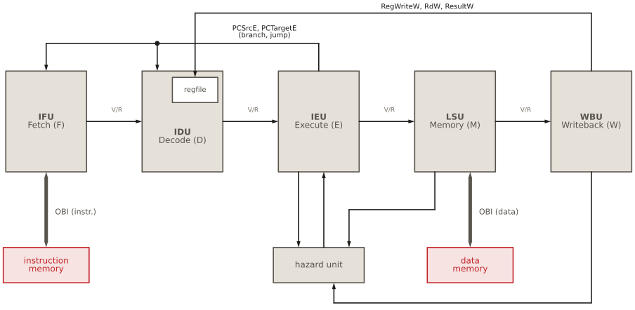

# Pipeline hazards and the HIPV core {#sec-hazards .unnumbered}

## Goal for this week

- Know the three kinds of pipeline hazards: structural, data and control
- Understand how HIPV resolves each of them, and which part of the core
  does it
- Read the hazard unit: the forwarding conditions and their priority
- Put the five stages together: the top-level module `hipv_core` and its
  interface

## Introduction

::: {.content-visible when-format="revealjs"}
- The RV32I algorithm: one instruction **after** the other
- The pipeline: up to **five instructions at once**
- A **hazard**: a situation in which overlapping would give a different
  result than the algorithm
- Three kinds:
  - **structural**: two instructions need the same hardware
  - **data**: an instruction needs a result that is not written yet
  - **control**: the pipeline does not know yet which instruction comes next
:::

::: {.content-visible unless-format="revealjs"}
At the algorithmic level, RV32I is a loop that finishes one instruction
before it starts the next (see the [pipeline chapter](06-pipeline-structure.qmd)).
The pipeline breaks that promise on purpose: it keeps up to five
instructions in flight, each in a different stage. That is where its speed
comes from, but it means that an instruction can start before the ones in
front of it have finished.

A **hazard** is a situation in which this overlap would produce a different
result than the sequential algorithm. Hazards come in three kinds:

- A **structural hazard**: two instructions need the same piece of
  hardware in the same cycle.
- A **data hazard**: an instruction needs a value that an earlier
  instruction has computed, but not yet written to the register file.
- A **control hazard**: the pipeline must fetch the next instruction
  before it knows which instruction that is, because a branch in front of
  it is not resolved yet.

Every pipelined processor has to deal with all three. In the chapters on
the individual stages we met the pieces of HIPV that do this one at a time:
the forwarding multiplexers in Execute, the write-first register file in
Decode, the flush in Fetch and Decode, and the elastic handshake that
connects them all. This chapter puts these pieces together, adds the last
missing block, the hazard unit, and then assembles the whole core.
:::

## Structural hazards

::: {.content-visible when-format="revealjs"}
- Two instructions want the same hardware **in the same cycle**
- HIPV avoids them by construction:
  - **two memory ports**: instruction (Fetch) and data (Memory stage)
  - register file: **two read ports** (Decode) + **one write port**
    (Writeback)
  - one ALU per stage that needs one, a separate adder for branch targets
:::

::: {.content-visible unless-format="revealjs"}
A structural hazard arises when the hardware cannot serve all the
instructions that need it in the same cycle. The classic example is a
single memory port: in a cycle in which the Memory stage loads data, Fetch
cannot fetch an instruction, and one of them must wait.

HIPV avoids structural hazards by construction, by giving every stage the
resources it needs:

- **Two memory ports.** Fetch has its own OBI port for instructions, and
  the Memory stage its own for data. Both can work in the same cycle.
- **Enough register file ports.** Decode reads two registers through two
  read ports, while Writeback writes a third through a separate write port.
- **Separate arithmetic.** Execute computes branch targets with a
  dedicated adder (`targetadd`) and evaluates branch conditions with its
  own comparator (`branchcmp`), so the ALU is never needed twice.

Even if two stages did compete, the elastic handshake would turn the
conflict into a stall rather than an error: the stage that has to wait
simply holds `ready` or `valid` low. The SoC relies on exactly this when
both ports of the core reach the same slave through the interconnect, which
then grants one of them and makes the other wait, as we will see later in
the course.
:::

## Data hazards

::: {.content-visible when-format="revealjs"}
```
add  x5, x1, x2    # producer: writes x5
sub  x6, x5, x3    # consumer: reads x5 one instruction later
```

- `sub` reads `x5` in **Decode**
- `add` writes `x5` in **Writeback**, three cycles later
- Without help, `sub` computes with the **old** `x5`
- Read after write: **RAW** hazard
:::

::: {.content-visible unless-format="revealjs"}
A data hazard arises when an instruction reads a register that an earlier
instruction has not written yet:

```
add  x5, x1, x2    # producer: writes x5
sub  x6, x5, x3    # consumer: reads x5 one instruction later
```

`sub` reads `x5` from the register file in Decode. At that moment `add` is
one stage ahead, in Execute, where its result is just being computed. The
register file receives that result only when `add` reaches Writeback,
three cycles later. Without help, `sub` would compute with the old value
of `x5`. This kind of dependency is called **read after write** (RAW): the
consumer reads a register after the producer writes it, in program order,
but the pipeline would do the read first.

RISC-V has two other kinds of dependency, write after read and write after
write, but HIPV cannot suffer from them: all instructions read their
registers in the same stage (Decode) and write them in the same stage
(Writeback), always in program order.
:::

### The distance decides the remedy

::: {.content-visible when-format="revealjs"}
| Distance | Producer is in | Remedy | Where |
|---|---|---|---|
| 1 | Memory | forward `ForwardDataM` | Execute |
| 2 | Writeback | forward `ResultW` | Execute |
| 3 | writing this cycle | write-first bypass | register file |
| ≥ 4 | already written | none needed | — |

```
add  x5, x1, x2   # producer
sub  x6, x5, x3   # distance 1: forward from M
or   x7, x5, x4   # distance 2: forward from W
and  x8, x5, x9   # distance 3: write-first register file
xor  x9, x5, x1   # distance 4: plain register read
```
:::

::: {.content-visible unless-format="revealjs"}
How a RAW hazard is resolved depends on the distance between the producer
and the consumer, counted in instructions. When the consumer is in Execute
and needs its operands, the producer is as many stages further down the
pipeline:

```
add  x5, x1, x2   # producer
sub  x6, x5, x3   # distance 1: forward from M
or   x7, x5, x4   # distance 2: forward from W
and  x8, x5, x9   # distance 3: write-first register file
xor  x9, x5, x1   # distance 4: plain register read
```

| Distance | Producer is in | Remedy | Where |
|---|---|---|---|
| 1 | the Memory stage | forward its result, `ForwardDataM` | forwarding multiplexers in Execute |
| 2 | Writeback | forward its result, `ResultW` | forwarding multiplexers in Execute |
| 3 | Writeback, while the consumer is in Decode | write-first bypass | register file in Decode |
| ≥ 4 | already retired | none: the register file holds the value | — |

The two forwarding cases need the **hazard unit**, which decides when a
forwarded value replaces the register operand. The third case is handled
inside the register file, by the write-first read ports described in the
[IDU chapter](06c-idu.qmd): when the consumer reads in Decode in the same
cycle in which the producer writes in Writeback, the register file returns
the value being written.
:::

### The hazard unit

{#fig-hazard}

::: {.content-visible when-format="revealjs"}
```systemverilog
module hazard (input  logic [4:0] Rs1E, Rs2E,
               input  logic [4:0] RdM, RdW,
               input  logic       RegWriteM, RegWriteW,
               output logic [1:0] ForwardAE, ForwardBE);

  import hipv_pkg::*;

  always_comb
    if (RegWriteM & (Rs1E == RdM) & (Rs1E != 5'b0)) ForwardAE = FWD_MEM;
    else if (RegWriteW & (Rs1E == RdW) & (Rs1E != 5'b0)) ForwardAE = FWD_WB;
    else ForwardAE = FWD_RF;
  // ForwardBE: the same with Rs2E
endmodule
```
:::

::: {.content-visible unless-format="revealjs"}
The hazard unit is a small, purely combinational block (@fig-hazard). It
compares the source registers of the instruction in Execute with the
destination registers of the instructions in the Memory stage and in
Writeback, and drives the selects of the forwarding multiplexers:

```systemverilog
module hazard (input  logic [4:0] Rs1E, Rs2E,
               input  logic [4:0] RdM, RdW,
               input  logic       RegWriteM, RegWriteW,
               output logic [1:0] ForwardAE, ForwardBE);

  import hipv_pkg::*;

  always_comb
    if (RegWriteM & (Rs1E == RdM) & (Rs1E != 5'b0)) ForwardAE = FWD_MEM;
    else if (RegWriteW & (Rs1E == RdW) & (Rs1E != 5'b0)) ForwardAE = FWD_WB;
    else ForwardAE = FWD_RF;

  always_comb
    if (RegWriteM & (Rs2E == RdM) & (Rs2E != 5'b0)) ForwardBE = FWD_MEM;
    else if (RegWriteW & (Rs2E == RdW) & (Rs2E != 5'b0)) ForwardBE = FWD_WB;
    else ForwardBE = FWD_RF;

endmodule
```

The two blocks are identical, one for each operand. The values `FWD_MEM`,
`FWD_WB` and `FWD_RF` come from `hipv_pkg`, and they are the selects of
`fwdamux` and `fwdbmux` in the [IEU](06d-ieu.qmd).
:::

### The forwarding conditions

::: {.content-visible when-format="revealjs"}
Forward from a stage when **all three** hold:

| Term | Question | Why |
|---|---|---|
| `Rs1E == RdM` | does it write **my** source register? | only then it has my value |
| `RegWriteM` | does it **write** a register at all? | stores and branches have bits in `rd` too; bubbles must not match |
| `Rs1E != 0` | is my source **not** `x0`? | `x0` is always 0, even if an instruction "writes" it |

- Both M and W match: **M wins**, it holds the newer value
:::

::: {.content-visible unless-format="revealjs"}
A value is forwarded from a stage when three conditions hold together:

| Term | Question | Why it is needed |
|---|---|---|
| `Rs1E == RdM` | Does the instruction in that stage write *my* source register? | Only then does it hold a newer value of my operand. |
| `RegWriteM` | Does that instruction write a register at all? | Stores and branches have bits in their `rd` field too, but they never write `rd`. Without this check, the immediate bits of a store could trigger a bogus forward. |
| `Rs1E != 0` | Is my source register something other than `x0`? | `x0` is always zero. `addi x0, x1, 5` has `RegWrite = 1`, but its write is discarded, and forwarding its result would give a non-zero `x0`. |

`RegWriteM` and `RegWriteW` are already qualified with the valid bits of
their stages, by the LSU and the WBU. A bubble therefore never matches,
even though its pipeline registers still contain the fields of an older
instruction.

**Priority.** If both the Memory stage and Writeback write the register,
the Memory stage wins:

```
add  x5, x1, x2    # in W: older value of x5
sub  x5, x5, x3    # in M: newer value of x5
and  x6, x5, x4    # in E: must use the value from sub
```

In program order, the instruction in the Memory stage is the younger of the
two, so it holds the most recent value of `x5`. Checking it first, in the
`if`, gives it priority.
:::

### Loads: no stall unit needed

{#fig-hazard-loaduse}

::: {.content-visible when-format="revealjs"}
```
lw   x5, 0(x10)
add  x6, x5, x1    # needs x5 right away
```

- Classic pipeline: the load data comes **too late** for forwarding, so a
  dedicated **load-use stall** is needed
- HIPV: the load **holds** the Memory stage until its data arrives
  - `ReadyM = 0`, the `add` waits in Execute
  - `ForwardDataM` = the **load data**, not the address
  - `HoldE` refreshes the operand while it waits
- The hazard unit has **no stall outputs**
:::

::: {.content-visible unless-format="revealjs"}
One data hazard cannot be solved by forwarding in a classic five-stage
pipeline:

```
lw   x5, 0(x10)
add  x6, x5, x1    # needs x5 right away
```

When the `add` is in Execute, the load is in the Memory stage, and its data
arrives from memory only at the end of that stage, too late for the `add`.
Classic designs therefore add a **load-use stall**: the hazard unit detects
this pattern and freezes Fetch and Decode for one cycle.

HIPV needs no such logic, because the elastic handshake already does it
(@fig-hazard-loaduse). A load holds the Memory stage until its transaction
is complete (`ReadyM = 0`), and while it does, the `add` simply waits in
Execute. The hazard unit already selects `FWD_MEM` for it, and the LSU
makes sure that `ForwardDataM` is the loaded data, not the address. In the
cycle in which the data is there, `ReadyM` rises, and the `add` leaves
Execute with the correct operand. Before that, the forwarded value is
garbage, but it is never used, because the `add` cannot leave. The refresh
loop (`HoldE`) in the IEU keeps the operand register up to date while the
instruction waits, so that no forwarded value is lost if the producer
retires in the meantime (see the [IEU chapter](06d-ieu.qmd)).

The same mechanism also covers stores and slow memories: whatever the
Memory stage is doing, Execute waits for it, and forwarding delivers the
right value once it can leave. This is why the hazard unit of HIPV has no
stall outputs at all.
:::

## Control hazards

::: {.content-visible when-format="revealjs"}
- A branch is resolved in **Execute**
- By then, Fetch and Decode already hold instructions **behind** it
- If the branch is taken, they are on the **wrong path**
- HIPV: fetch sequentially, and **flush** on a taken branch or jump
  - `PCSrcE` → Fetch loads `PCTargetE`, drops what it has, sets `DiscardF`
  - `PCSrcE` → Decode drops `ValidD`
  - Execute and later: untouched, they are **older** than the branch
:::

::: {.content-visible unless-format="revealjs"}
A control hazard arises because Fetch must choose the next instruction every
cycle, but whether a branch is taken, and where it goes, is known only when
the branch reaches Execute. By then, the stages behind it, Fetch and
Decode, already hold the instructions that follow it in memory.

HIPV handles this in the simplest way: it always continues fetching
sequentially, as if every branch were not taken, and repairs the damage
when the guess was wrong. When Execute resolves a taken branch or a jump,
it raises `PCSrcE` for one cycle, and two things happen at once:

- **Fetch** loads its PC with `PCTargetE` and starts fetching from there.
  An instruction it already holds is dropped, and a fetch that is still on
  its way from memory is discarded on arrival, using the discard flag
  (see the [IFU chapter](06b-ifu.qmd)).
- **Decode** drops its instruction by gating `ValidD` with `~PCSrcE`, and
  its valid bit is cleared at the same edge (see the
  [IDU chapter](06c-idu.qmd)).

This is a **flush**: the wrong-path instructions become bubbles. Execute
and the later stages are not touched. The instructions there are older than
the branch, and the branch itself continues to the Memory stage and retires
normally.

Two details make the flush safe in the elastic pipeline. `PCSrcE` is
qualified with the valid bit of Execute, so a bubble never redirects, and
gated with `ReadyM`, so the redirect fires only in the cycle in which the
branch actually leaves Execute. While the branch waits, for example behind
a load whose data it compares, its operands may not be final yet, and a
redirect issued from them could not be taken back.

The cost of a taken branch is the work thrown away in Fetch and Decode,
plus the time to fetch the target. Better processors reduce it with
**branch prediction**, guessing the outcome in Fetch already. HIPV does not
predict, which keeps it simple, and leaves an obvious direction for
improvement.
:::

## Summary of hazards

::: {.content-visible when-format="revealjs"}
| Hazard | Remedy | Where |
|---|---|---|
| structural | separate ports and units | everywhere |
| RAW, distance 1–2 | forwarding | hazard unit + IEU |
| RAW, distance 3 | write-first read | register file (IDU) |
| load-use, slow memory | stall by back-pressure | handshake (`ReadyM`) |
| forwarding during a stall | operand refresh | `HoldE` (IEU) |
| taken branch, jump | flush | `PCSrcE`: IFU, IDU |
:::

::: {.content-visible unless-format="revealjs"}
| Hazard | Remedy | Where |
|---|---|---|
| structural | separate memory ports, register file ports and adders | across the core |
| RAW at distance 1 or 2 | forwarding | hazard unit and forwarding multiplexers (IEU) |
| RAW at distance 3 | write-first read ports | register file (IDU) |
| load-use, slow memory | stall by back-pressure | handshake: `ReadyM` |
| producer retires while the consumer waits | operand refresh | `HoldE` loop (IEU) |
| taken branch or jump | flush of Fetch and Decode | `PCSrcE`: IFU, IDU |

What stands out is how little dedicated hazard logic HIPV needs. The hazard
unit has no stall outputs, and there is no separate flush controller. The
valid/ready handshake carries most of the work: a stage that cannot proceed
holds `ready` low, a stage with nothing to offer holds `valid` low, and a
flush is just a valid bit turned off.
:::

## The HIPV core

{#fig-hipv-core}

::: {.content-visible when-format="revealjs"}
- `hipv_core.sv`: the top level of the CPU
- **Purely structural**: six instances, wires between them
  - `ifu`, `idu`, `ieu`, `lsu`, `wbu`, `hazard`
- Every connection is one we met in a stage chapter
:::

::: {.content-visible unless-format="revealjs"}
We now have all the parts, and the top level of the CPU, `hipv_core.sv`,
puts them together (@fig-hipv-core). It contains no logic of its own. It
is purely structural: six instances, the five stages and the hazard unit,
and the wires that connect them. Every one of those connections is a
signal we have already met from one side or the other in the stage
chapters.
:::

### Interface of the CPU

::: {.content-visible when-format="revealjs"}
```systemverilog
module hipv_core (input  logic        clk, reset,
                  // OBI instruction port
                  output logic        ObiIReq,
                  input  logic        ObiIGnt,
                  output logic [31:0] ObiIAddr,
                  input  logic        ObiIRvalid,
                  input  logic [31:0] ObiIRdata,
                  // OBI data port
                  output logic        ObiDReq,
                  input  logic        ObiDGnt,
                  output logic [31:0] ObiDAddr,
                  output logic        ObiDWe,
                  output logic [3:0]  ObiDBe,
                  output logic [31:0] ObiDWdata,
                  input  logic        ObiDRvalid,
                  input  logic [31:0] ObiDRdata);
```

- Clock, reset, and **two OBI master ports**: that is all
:::

::: {.content-visible unless-format="revealjs"}
Seen from the outside, the whole CPU has a remarkably small interface: a
clock, a reset, and two OBI master ports.

```systemverilog
module hipv_core (input  logic        clk, reset,
                  // OBI instruction port
                  output logic        ObiIReq,
                  input  logic        ObiIGnt,
                  output logic [31:0] ObiIAddr,
                  input  logic        ObiIRvalid,
                  input  logic [31:0] ObiIRdata,
                  // OBI data port
                  output logic        ObiDReq,
                  input  logic        ObiDGnt,
                  output logic [31:0] ObiDAddr,
                  output logic        ObiDWe,
                  output logic [3:0]  ObiDBe,
                  output logic [31:0] ObiDWdata,
                  input  logic        ObiDRvalid,
                  input  logic [31:0] ObiDRdata);
```

| Group | Signals | Connected to |
|---|---|---|
| Clock and reset | `clk`, `reset` (synchronous, active high) | every stage |
| Instruction port (read only) | `ObiIReq`, `ObiIGnt`, `ObiIAddr`, `ObiIRvalid`, `ObiIRdata` | the IFU (`Obi…F`) |
| Data port (read and write) | `ObiDReq`, `ObiDGnt`, `ObiDAddr`, `ObiDWe`, `ObiDBe`, `ObiDWdata`, `ObiDRvalid`, `ObiDRdata` | the LSU (`Obi…M`) |

The instruction port is the read-only subset of OBI, the data port the full
set with the write signals. The names change at the boundary: inside, the
ports carry the stage suffix (`ObiReqF`, `ObiReqM`); outside, they are
named after their role (`ObiIReq` for instructions, `ObiDReq` for data),
which is what the memory system on the other side cares about.

Everything a program does reaches the outside world through these two
ports. There are no interrupt inputs and no debug port yet. After reset,
the core starts fetching at address `0x00000000`, the reset value of the PC
register in the IFU.
:::

### Inside the top level

::: {.content-visible when-format="revealjs"}
```systemverilog
  // E <-> M
  logic        ValidE, ReadyM;
  logic [31:0] ALUResultE, WriteDataE, PCPlus4E;
  ...
  // Execute
  ieu ieu(.clk(clk), .reset(reset),
          .ValidD(ValidD), .ReadyE(ReadyE),
          ...
          .ForwardAE(ForwardAE), .ForwardBE(ForwardBE),
          .ForwardDataM(ForwardDataM), .ResultW(ResultW),
          .PCSrcE(PCSrcE), .PCTargetE(PCTargetE),
          .ValidE(ValidE), .ReadyM(ReadyM), ...);

  // Hazard unit (forwarding)
  hazard hz(.Rs1E(Rs1E), .Rs2E(Rs2E), .RdM(RdM), .RdW(RdW),
            .RegWriteM(RegWriteM), .RegWriteW(RegWriteW),
            .ForwardAE(ForwardAE), .ForwardBE(ForwardBE));
```

- Wires grouped by **stage boundary**: F↔D, D↔E, E↔M, M↔W
- The suffix names the stage that **produces** the signal
:::

::: {.content-visible unless-format="revealjs"}
The body of `hipv_core` has two parts. First, the internal wires, declared
in groups, one group per boundary between two stages:

```systemverilog
  // F <-> D
  logic        ValidF, ReadyD;
  logic [31:0] InstrF, PCF, PCPlus4F;
  // D <-> E
  logic        ValidD, ReadyE;
  logic [31:0] RD1D, RD2D, ImmExtD, PCD, PCPlus4D;
  ...
  // E <-> M
  logic        ValidE, ReadyM;
  logic [31:0] ALUResultE, WriteDataE, PCPlus4E;
  ...
  // redirect
  logic        PCSrcE;
  logic [31:0] PCTargetE;
  // M <-> W
  logic        ValidM, ReadyW;
  logic [31:0] ALUResultM, ReadDataM, PCPlus4M, ForwardDataM;
  ...
  // forwarding
  logic [1:0]  ForwardAE, ForwardBE;
```

Then the six instances, connected by name. Because every signal carries the
suffix of the stage that produces it, the connections are easy to check:
an output of the IEU always ends in `E`, and it appears as an input of the
LSU or as feedback to an earlier stage. Two instances show the pattern:

```systemverilog
  // Execute
  ieu ieu(.clk(clk), .reset(reset),
          .ValidD(ValidD), .ReadyE(ReadyE),
          .RD1D(RD1D), .RD2D(RD2D), .ImmExtD(ImmExtD), .PCD(PCD), .PCPlus4D(PCPlus4D),
          .Rs1D(Rs1D), .Rs2D(Rs2D), .RdD(RdD), .Funct3D(Funct3D),
          .RegWriteD(RegWriteD), .MemWriteD(MemWriteD), .BranchD(BranchD),
          .JumpD(JumpD), .JalrD(JalrD), .ResultSrcD(ResultSrcD),
          .ALUSrcAD(ALUSrcAD), .ALUSrcBD(ALUSrcBD), .ALUControlD(ALUControlD),
          .ForwardAE(ForwardAE), .ForwardBE(ForwardBE),
          .ForwardDataM(ForwardDataM), .ResultW(ResultW),
          .PCSrcE(PCSrcE), .PCTargetE(PCTargetE),
          .ValidE(ValidE), .ReadyM(ReadyM),
          .ALUResultE(ALUResultE), .WriteDataE(WriteDataE), .PCPlus4E(PCPlus4E),
          .RdE(RdE), .Rs1E(Rs1E), .Rs2E(Rs2E), .Funct3E(Funct3E),
          .RegWriteE(RegWriteE), .MemWriteE(MemWriteE), .ResultSrcE(ResultSrcE));

  // Hazard unit (forwarding)
  hazard hz(.Rs1E(Rs1E), .Rs2E(Rs2E), .RdM(RdM), .RdW(RdW),
            .RegWriteM(RegWriteM), .RegWriteW(RegWriteW),
            .ForwardAE(ForwardAE), .ForwardBE(ForwardBE));
```

The IEU is the busiest instance, because Execute is where the pipeline's
feedback paths meet: the forwarded values come in from the Memory stage and
Writeback, the forwarding selects come from the hazard unit, and the
redirect goes out to Fetch and Decode. Three kinds of connections appear
in the whole module:

- **Forward connections**, from each stage to the next: the handshake pair
  and the payload. They are the pipeline itself.
- **Backward connections**: `ready` against the flow in every handshake;
  the redirect `PCSrcE`/`PCTargetE` from Execute to Fetch and Decode; the
  write port `RegWriteW`/`RdW`/`ResultW` from Writeback to the register
  file in Decode; and the forwarded values `ForwardDataM` and `ResultW`
  into Execute.
- **The hazard unit**, which listens to the register numbers of three
  stages and talks only to Execute.

One output of the WBU, `ValidW`, is connected to nothing. It marks the cycle
in which an instruction retires, which is useful in waveforms, and it is
the natural hook for an instruction trace port in the future.
:::

### How fast is it?

::: {.content-visible when-format="revealjs"}
- Correct first, fast later
- The IFU fetches at most **1 instruction every 3 cycles**
- Loads and stores add their memory latency in the Memory stage
- Each limitation is a self-contained improvement
:::

::: {.content-visible unless-format="revealjs"}
HIPV was designed to be correct and readable first. It is not fast. With
ideal memories, the IFU fetches at most one instruction every three cycles,
because it waits for each fetch to finish before it starts the next. Loads
and stores add the latency of the data memory in the Memory stage, and a
taken branch throws away the work in Fetch and Decode. The rest of the
pipeline could handle one instruction per cycle, but it is starved by
Fetch.

This is deliberate. Each of these limitations can be removed without
touching the rest of the design, thanks to the handshake between the
stages, and each removal is a project with a measurable speedup. Some of
them are listed at the end of this chapter.
:::

## You have come a long way

::: {.content-visible when-format="revealjs"}
- From a single flip-flop to a **working RISC-V processor**
- Every line of `hipv_core` is now something you can read and explain
- It runs real programs, compiled from C
:::

::: {.content-visible unless-format="revealjs"}
::: {.callout-tip}
## Congratulations!

Take a moment to look back. A few weeks ago we started with a single
flip-flop and a multiplexer. Since then, you have learned to describe
hardware in SystemVerilog, to design finite state machines, and to build
a pipeline stage by stage: fetching over a bus protocol, decoding an
instruction set, executing with forwarding, accessing memory, and writing
back. Now you have put them together into a complete, pipelined RISC-V
processor that runs real programs compiled from C.

Every line of `hipv_core` is now something you can read and explain, and
that is not a small thing: the same ideas, handshakes, pipeline registers,
forwarding and flushes, are at the heart of the processors in your phone
and your laptop. They are just bigger.
:::
:::

## What comes next

::: {.content-visible when-format="revealjs"}
- **Memory**: how the memories behind the OBI ports are built
- **Verification with cocotb**: how we know that HIPV is correct
- **The HIPV SoC**: interconnect, peripherals (UART, timer, GPIO)
- **FPGA**: running HIPV on the Nexys A7 board
:::

::: {.content-visible unless-format="revealjs"}
A processor on its own does nothing: it needs memory to hold its program
and data, and peripherals to talk to the world. The coming lectures build
the rest of the system around the core:

- **Memory.** What sits behind the two OBI ports: how memories are
  described in SystemVerilog, and how an FPGA implements them.
- **Verification with cocotb.** How we know that HIPV is correct. Every
  stage in this book has a testbench written in Python with cocotb, and
  the core is tested by running whole programs against a model of the
  memory.
- **The HIPV SoC.** The interconnect that lets the core reach the memory
  and the peripherals, and the peripherals themselves: a UART, a timer and
  GPIO.
- **FPGA.** Synthesizing the SoC and running programs on the Nexys A7
  board.
:::

## Directions for future work

::: {.content-visible when-format="revealjs"}
- **Faster fetch**: overlap fetches, a prefetch buffer → 1 instruction/cycle
- **Branch prediction**: fewer flushed instructions
- **Store buffer**: a store need not wait for its response
- **M extension**: multiply/divide as a multi-cycle unit in Execute
- **Traps, interrupts, CSRs**: `ecall`, timer interrupt, `mret`
- **Misaligned accesses**: detect them, or split them
- **Trace port** (RVFI) on `ValidW`: formal verification

Source code: <https://github.com/RatkoFri/HIPV-SoC>
:::

::: {.content-visible unless-format="revealjs"}
HIPV is a starting point, and it is built to be extended. If you want to go
further, here are directions, roughly in order of difficulty. Each one
touches only a few modules, and the handshake between the stages keeps the
rest of the core unchanged:

- **A faster fetch unit.** Issue the next request before the previous
  response arrives, and keep the extra instructions in a small buffer.
  This alone could bring HIPV close to one instruction per cycle.
- **Branch prediction.** Guess the outcome of a branch in Fetch, from its
  direction or its history, so that fewer instructions are flushed.
- **A store buffer.** Let a store leave the Memory stage as soon as its
  request is granted, instead of waiting for the response.
- **The M extension.** Add multiplication and division. Division takes
  many cycles, and the elastic handshake makes a multi-cycle unit in
  Execute natural: it holds `ReadyE` low until the result is ready, and the
  refresh loop keeps its operands correct while it waits.
- **Traps, interrupts and CSRs.** Implement `ecall`, `ebreak`, the
  control and status registers and `mret`, and connect the timer as an
  interrupt source. This is what an operating system needs.
- **Misaligned accesses.** Detect them and raise an exception, or split
  them into two bus transactions.
- **An instruction trace port.** Attach the RISC-V Formal Interface
  (RVFI) to `ValidW`, and verify HIPV formally against the ISA
  specification.

The complete source code of HIPV, with all the testbenches, the software
and the FPGA flow, is on GitHub:

<https://github.com/RatkoFri/HIPV-SoC>

Clone it, run the tests, break something and see which test catches it,
and then make it better.
:::
